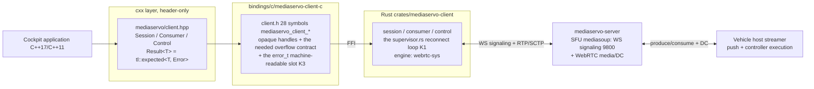

# MediaServo client C++ SDK Manual (Cockpit / Consumer Side)

> Status: active · 2026-09-23 · Source of truth = `bindings/cxx/mediaservo-client-cxx/include/mediaservo/client.hpp`
> and `bindings/c/mediaservo-client-c/include/mediaservo/client.h` (the 28-symbol C face after S6 batch 1b; cross-checked name by name)

## 1. Positioning & Applicable Scenarios

`mediaservo::client` (a C++ header-only binding over the `mediaservo_client_*` C ABI) is the
**cockpit/consumer-side SDK**: account login exchanges for a JWT → room discovery → join a room and consume
SFU video → a control DataChannel carrying outbound commands and inbound acks → dual-path e-stop delivery.
Per the C4 revision convention: client = the consumer/participant SDK (pull-centric + a remote-control
capability bit; control permission is adjudicated by the server account's `can_control`, not a local role).

Typical scenarios:

| Scenario | Usage |
|----------|-------|
| Teleoperation cockpit | `list_rooms` discovers stream rooms + the whole-vehicle control room → a dual-Session pairing (see §8's two-room convention) → `consume` video + the `open_control`/`send`/`on_ack` control loop |
| Monitoring wall / NVR playback end | multiple `Session::consume` (K4: one pump per stream, no cross-impact) + `Consumer::stats` mini readouts |
| Safety e-stop | `Session::emergency_stop` (the HMAC-signed form, W4b) |
| A ROS2 cockpit bridge | `bindings/cxx/mediaservo-client-cxx/examples/ros2_node/` (the pkg-config consumption form) |

Not applicable: the push/capture side (that's the `mediaservo::field` / host binary territory).

## 2. Principles & Architecture

Three layers: the C++ RAII thin layer (header-only, zero compilation) → the stable C ABI face (28 symbols,
`extern "C"`) → the Rust `mediaservo-client` crate (the cdylib `libmediaservo_client.so`).



Key points (all from the header contract comments):

- **Namespace**: the cxx layer lives in `mediaservo::client` (`Session` / `Consumer` / `Control` / `Config` /
  `State` / `DcState`); the error types reuse `mediaservo::Error` / `mediaservo::Result`
  (`bindings/cxx/include/mediaservo/detail/result.hpp`).
- **The S6 batch-1b rename**: all C symbols `ms_client_*` → `mediaservo_client_*`, **zero aliases** (the old
  symbols simply vanished).
- **⊘ Old forms kept one cycle** (behavior remapped, not new semantics): the `last_error` global slot /
  the `consume_video` first-stream bridge / the session-union `video_stats` — new code uses handle-level
  errors + `wait_video`+`consume` multi-stream + `Consumer::stats`.
- **The error channel is Result (not exceptions)**; misusing `value()`/`error()` throws `tl::bad_expected_access<Error>`.
- All blocking calls `block_on` a process-shared multi-thread tokio runtime; the ack pump / WS read loop /
  frame pumps are background tasks.

## 3. Lifecycle Sequence

```mermaid
sequenceDiagram
    participant A as Cockpit application
    participant S as mediaservo::client::Session
    participant V as SFU server (9800)
    participant H as Vehicle host/controller

    A->>V: POST /api/auth/login (the login() free function)
    V-->>A: JWT
    A->>V: GET /api/rooms (the list_rooms() free function)
    V-->>A: [{"room_id":..,"kind":"video"|"audio"|"control"}]
    A->>S: Session::connect(Config{signaling_url, room, jwt|psk pick one, role, hmac_key_file?, identity_dir?})
    S->>V: WS connect + RoomJoin (carrying the protocol expectation)
    V-->>S: RoomJoined{protocol = min(both)} (S0 negotiation; current generation 3)
    Note over S: negotiated() reads the agreed version
    A->>S: wait_video(timeout_ms) → producer_id
    A->>S: consume(producer_id, frame_cb) → Consumer (one pump per stream)
    S->>V: transport negotiation + Consume
    V-->>S: RTP (decoded I420 frames)
    S-->>A: frame_cb(mediaservo_client_frame_t) (pump thread)
    A->>S: open_control({"chassis"}) → Control
    S->>V: CreateDataProducer x labels (protocol <2 is locally pre-rejected with ERR_PROTOCOL)
    A->>C: Control::send(label, seq, cmd, payload_json)
    C->>V: the SCTP command envelope {seq,cmd,payload}
    V->>H: DataChannel forwarding
    H-->>V: ControlAck
    V-->>C: ack_json
    C-->>A: the on_ack callback (token registration / off_ack deregistration)
    Note over S: On disconnect the supervisor reconnect loop runs<br/>state()=Reconnecting → Connected<br/>an auth-family/4101 rejection → Failed (terminal)
    A->>S: close() (RAII destruction does it automatically; does NOT implicitly close Consumers/Controls)
```

Reconnect/supervision behavior (supervisor.rs K1, observed via the C face): the `Session::state()` snapshot +
the `Session::on_state(cb)` callback (**reports changes only**; read the initial state via `state()`).
The numeric values: `Disconnected(0)` (auto_reconnect off and disconnected) / `Connected(1)` /
`Reconnecting(2)` (inside the reconnect loop) / `Failed(3)` (a non-retryable rejection: the auth family /
4101; terminal). Note: `set_auto_reconnect` exists on the Rust face but is **not exposed as a switch on the
C/cxx 28-symbol face** (the reconnect loop is always on by default).

## 4. API Tables (the cxx layer, name-by-name from client.hpp)

### Free Functions

| Signature | Description |
|-----------|-------------|
| `Result<std::string> version()` | The SDK version `MAJOR.MINOR.PATCH` |
| `Result<std::string> login(const std::string& http_base_url, const std::string& username, const std::string& password)` | POST `{base}/api/auth/login` to exchange for a JWT (blocking; v1 is plaintext http only) |
| `Result<std::string> list_rooms(const std::string& http_base, const std::string& jwt)` | GET `{base}/api/rooms`, returning a JSON array `[{"room_id":..,"kind":..}]`, unparsed at this layer; an invalid token/wrong role → `ERR_UNAUTHORIZED` |

### struct Config

```cpp
struct Config {
    std::string signaling_url; // "ws://host:9800/ws"
    std::string room;          // the room ID
    std::string jwt;           // login()'s output (pick exactly one non-empty with psk)
    std::string hmac_key_file; // the e-stop key file (0600; empty = unsigned)
    std::string psk;           // direct PSK (pick exactly one non-empty with jwt)
    std::string identity_dir;  // the device-identity instance directory (empty = off; combinable with jwt/psk; all three = INVALID_ARG)
    std::string role;          // "Client" (default) / "Viewer" / "Remote"; an empty string = "Client"
};
```

Note: `Client`/`Viewer` are locally identical (PeerRole::Consumer); the control-permission difference is
adjudicated by the server account's `can_control` gate; `Remote` = the cockpit's counterpart role.

### class Session (move-only RAII; the destructor closes; default construction = closed)

| Signature | Description |
|-----------|-------------|
| `static Result<Session> connect(const Config& cfg)` | Signaling connect + room join (blocking) |
| `Result<uint32_t> negotiated() const` | The negotiated dialect version (S0; an old server = 1) |
| `Result<State> state() const` | A snapshot of the connection state (the reconnect-loop observation face) |
| `Result<void> on_state(std::function<void(State)> cb)` | Accumulating registration of a state callback; cannot be deregistered; released at close |
| `Result<std::string> wait_video(uint64_t timeout_ms)` | Purely waits for a video producer in the room, returning the producer_id; timeout → `ERR_TIMEOUT`, disconnect → `ERR_STATE` |
| `Result<Consumer> consume(const std::string& producer_id, std::function<void(const mediaservo_client_frame_t&)> cb)` | Subscribes to one video stream (K4 multi-stream; one pump each, no cross-impact) |
| `Result<void> consume_video(cb)` | ⊘ The first-stream bridge (kept one cycle; a repeat call = `ERR_STATE`); new code uses wait_video+consume |
| `Result<std::string> video_stats()` | ⊘ The session-level union JSON; for precise multi-stream readouts use `Consumer::stats()` |
| `Result<Control> open_control(const std::vector<std::string>& labels)` | The outbound control channel set (once per session; protocol <2 is locally pre-rejected) |
| `Result<void> emergency_stop(const Control& ctl, const std::string& label, uint64_t seq, const std::string& payload_json)` | Dual-path e-stop delivery (the DC fast path + a signaling audit copy); OK = delivery succeeded, not that it executed |
| `Result<void> close() noexcept` | Idempotent; joins the pumps + user_frees each; **does NOT implicitly close Consumers/Controls** |

### class Consumer (move-only RAII; Session.close does not implicitly close it)

| Signature | Description |
|-----------|-------------|
| `std::string id() const` | This stream's producer id (closed/failed = an empty string) |
| `Result<std::string> stats()` | Single-stream video stats JSON (same key table as video_stats) |
| `Result<void> close() noexcept` | Idempotent; joins the pump within 250ms; user_free exactly once |

### class Control (move-only RAII)

| Signature | Description |
|-----------|-------------|
| `Result<uint64_t> on_ack(std::function<void(const std::string&)> cb)` | Accumulating ack-callback registration, returning a deregistration token; the first registration starts the pump |
| `Result<void> off_ack(uint64_t token)` | Deregisters by token (reclaimed by the pump next round within 1s; an in-flight round may still fire once) |
| `Result<void> send(const std::string& label, uint64_t seq, const std::string& cmd, const std::string& payload_json)` | The command envelope {seq,cmd,payload}; payload_json "" = null; the caller increments seq (D-H3 makes resends idempotent-safe) |
| `Result<DcState> ready_state() const` | The DC readiness state (gate before send/e-stop): Connecting(0)/Open(1)/Closing(2)/Closed(3) |
| `Result<uint64_t> buffered_amount()` | The SCTP backpressure watermark in bytes (0 = safe to append) |
| `Result<std::string> producer_ids()` | A JSON array of the server-assigned data producer ids (an observation face) |
| `Result<void> close() noexcept` | Idempotent; joins the ack pump then reclaims the full registry |

### Error (the machine-readable form, `bindings/cxx/include/mediaservo/detail/result.hpp`)

```cpp
struct Error {
    int code;             // MEDIASERVO_CLIENT_ERR_* (see section 6)
    std::string message;  // human-readable details (handle-level or the global last_error)
    uint16_t wire_code;   // the server wire code read back (0 = local/no-code domain), e.g. 4012 ControlDenied
    bool retryable;       // the retryable family (a C mirror of D273's classification)
};
```

When a session-handle-shaped call fails, wire_code/retryable are read back via
`mediaservo_client_session_error` (K3); on free functions/guard paths both bits = 0/false. The C side's
counterpart is `mediaservo_client_error_t{struct_size, code, wire_code, retryable}`; `struct_size` must be
filled with `sizeof`.

### The needed Buffer Contract (list_rooms / wait_video / video_stats / consumer id+stats / producer_ids / login)

The C face's out-params are `(char* buf, size_t cap, size_t* needed)`: when cap is insufficient → `*needed`
is written with the required byte count (incl. NUL) + `ERR_INVALID_ARG` returned (no half-writes). The cxx
layer's `detail::needed_read` already wraps this as **a first call at 4KiB, one auto-grow retry per the
needed value on overflow, a rejection above 64KiB** — the C++ caller sees only `Result<std::string>` and
never manages buffers.

## 5. Usage Examples

### 5.1 The Compile-Time Self-Proving Test (real code, network-free)

`bindings/cxx/mediaservo-client-cxx/tests/test_client.cpp` (191 lines, 14 assertion cases: version /
the login argument guards / the connect pick-one-credential rule / a typed error on a dead-loopback-port /
default-construction closed semantics / move semantics / the State numeric contract / Consumer closed
semantics / the Error machine-readable bits / the C-face strerror). The compile line (verbatim from the
file-header comment):

```bash
g++ -std=c++17 -I bindings/cxx/include -I bindings/c/include \
    -I bindings/c/mediaservo-client-c/include \
    -I bindings/cxx/mediaservo-client-cxx/include \
    bindings/cxx/mediaservo-client-cxx/tests/test_client.cpp \
    -L target/debug -lmediaservo_client -o /tmp/test_client_cxx
```

A representative case (verbatim from test_client.cpp):

```cpp
static void test_default_constructed_closed() {
    Session s;
    assert(!static_cast<bool>(s));
    auto n = s.negotiated();
    assert(!n.has_value());
    assert(n.error().code == MEDIASERVO_CLIENT_ERR_INVALID_ARG);
    assert(n.error().message == "closed");
}
```

### 5.2 The Headless Teleoperation Closed Loop (real code)

`bindings/cxx/examples/control_demo/main.cpp` (95 lines: login→join→open_control→on_ack→
12 resends of steer with the same seq → exit 0 on any ack). The core section, verbatim:

```cpp
auto token = ms::login(http_base, user, pass);
if (!token) { fail("login", token.error()); return 1; }

ms::Config cfg;
cfg.signaling_url = ws_url;
cfg.room = room;
cfg.jwt = token.value();
cfg.role = "Client";
auto session = ms::Session::connect(cfg);
if (!session) { fail("session connect", session.error()); return 1; }

auto ctl = session->open_control({label});
auto hooked = ctl->on_ack([](const std::string& ack_json) {
    std::printf("ack: %s\n", ack_json.c_str());
    g_ack_received.store(true);
});

const uint64_t seq = 1;
for (int attempt = 0; attempt < 12 && !g_ack_received.load(); ++attempt) {
    auto sent = ctl->send(label, seq, "steer", "{\"deg\":0.0}");
    if (!sent) { fail("send", sent.error()); return 1; }
    std::this_thread::sleep_for(std::chrono::seconds(5));
}
// RAII: ctl → session destructing in reverse order = closing in forward order
```

Endpoints/credentials all come from env vars (`MSRTC_HTTP_BASE` / `MSRTC_WS_URL` / `MSRTC_ROOM` /
`MSRTC_USER` / `MSRTC_PASS`, optional `MSRTC_LABEL`), no defaults — the G13 discipline.

### 5.3 Multi-Stream Video Consumption (real C-face usage, rewritten in cxx form)

An RAII rewrite of the C header's usage comments (the client.h file header, a real sequence):

```cpp
auto pid = session.wait_video(30000);            // Result<std::string> producer_id
if (!pid) { /* ERR_TIMEOUT / ERR_STATE */ }
auto cons = session.consume(pid.value(), [](const mediaservo_client_frame_t& f) {
    // f.data = contiguous I420 planes, f.len bytes; valid only inside the callback — copy to keep
    // the callback fires on the pump thread and must return quickly; calling any client API (incl. close) inside is forbidden
});
auto stats = cons->stats();                       // the single-stream readout JSON
```

> Note: a complete runnable cxx example of multi-stream `wait_video+consume` doesn't yet exist in the repo
> (imgui_viewer still uses the ⊘ `consume_video` first-stream bridge, see its `sessions.cpp` `join_room`
> video branch; after the docking rework the pointer = the file+symbol form); the passage above is a
> line-by-line RAII rewrite of client.h's real C file-header sequence, not hypothetical code.

### 5.4 The E-Stop (real code, imgui_viewer)

`bindings/cxx/examples/imgui_viewer/src/panels/control.cpp` `render_control` (the ESTOP button block):
`t->sess.emergency_stop(*t->ctl, "chassis", 900, payload)` — the signed/unsigned state is decided by
`Config::hmac_key_file` (see §8.2).

## 6. Error Semantics

### Error Codes (verbatim from client.h; 0 = OK, <0 = error)

| Macro | Value | Semantics |
|-------|-------|-----------|
| `MEDIASERVO_CLIENT_ERR_INVALID_ARG` | -1 | Invalid args / a call on a closed object (the cxx guard message="closed") / the needed overflow contract |
| `MEDIASERVO_CLIENT_ERR_LOGIN` | -2 | The login request/parse failed |
| `MEDIASERVO_CLIENT_ERR_UNAUTHORIZED` | -3 | InvalidCredentials / AuthRejected(4003/4010/4011) / RestRejected (the REST discovery face not 2xx) |
| `MEDIASERVO_CLIENT_ERR_DENIED` | -4 | ControlDenied (the server's 4012) |
| `MEDIASERVO_CLIENT_ERR_TIMEOUT` | -5 | Timeout{what} |
| `MEDIASERVO_CLIENT_ERR_SIGNAL` | -6 | Signal/LinkError (WS connect/disconnect/send-receive) |
| `MEDIASERVO_CLIENT_ERR_PROTOCOL` | -7 | ProtocolTooLow / ProtocolUnsupported / 4101 |
| `MEDIASERVO_CLIENT_ERR_MALFORMED` | -8 | MalformedResponse / UnsupportedScheme |
| `MEDIASERVO_CLIENT_ERR_STATE` | -9 | InvalidState (no channel open / the session or pump closed / a duplicate consume_video) |
| `MEDIASERVO_CLIENT_ERR_INTERNAL` | -10 | Server (an unclassified code) / WebRtc / Io / a panic backstop |

`mediaservo_client_strerror(code, buf, cap)` provides static text (truncation without error; an unknown
code gives "unknown error code").

### The Error Slots: Handle-Level vs Global (K3, double-written for one cycle)

- **New code**: on a session-handle-shaped failure read `mediaservo_client_session_error` (the machine-readable
  code/wire_code/retryable) + `mediaservo_client_session_last_error` (text). The cxx layer's
  `detail::make_error(code, h)` already goes this way automatically.
- **⊘ Global**: `mediaservo_client_last_error` (process-level, thread-safe) stays one cycle as a backstop —
  buffer-overflow (the needed contract) class failures go **only** to the return code + the global slot,
  never the handle slot.
- Free functions (login/list_rooms/version) and cxx guard paths have no handle → read the global slot,
  wire_code/retryable = 0/false.

### The retryable Classification (a C mirror of D273)

`Error::retryable == true` = the retryable family (transient; reconnecting/resending is meaningful); false
with `wire_code` in the auth family (4003/4010/4011) or 4101 = a terminal rejection — the supervisor
reconnect loop exits and `state()` stays `Failed`. `Control::send` receiving -4 (4012 ControlDenied) = the
account has no control permission; resending is pointless — report it in plain language.

## 7. Build & Linking

Prerequisite: `pixi run build-c` (or `./mediaservo.sh build bindings`) produces
`target/debug/libmediaservo_client.so` (+ the `.so.0` dev symlink). The cxx layer is header-only, zero
build artifacts.

### 7.1 Direct In-Repo Compilation (the dev posture)

```bash
g++ -std=c++17 \
  -I bindings/c/include -I bindings/cxx/include \
  -I bindings/c/mediaservo-client-c/include -I bindings/cxx/mediaservo-client-cxx/include \
  your_app.cpp -L target/debug -lmediaservo_client -Wl,-rpath,$PWD/target/debug
```

### 7.2 find_package (the delivery-tree posture)

`./msrtc.sh build bindings` (or `deploy bindings --prefix ...`) assembles `out/bindings/`:
`lib/` (the version-full trio + cmake/) + `include/mediaservo/` (C headers + cxx headers) + `pkgconfig/` +
`cmake/`.

```cmake
find_package(mediaservo REQUIRED COMPONENTS client)   # version check SameMajorVersion (the ABI MAJOR, D241)
target_link_libraries(my_app PRIVATE mediaservo::client)  # an INTERFACE imported target = include + libmediaservo_client.so
```

`mediaservo::client` is the fourth component in the one-package-multi-component mode (the OpenCV/Boost
convention; field/link/deck/client, driven by the `ALL_SDKS` constant); an unknown component name =
a configure-time FATAL_ERROR. The sdk-client delivery package contains only the client component (the cmake
config re-renders SDK_LIST per domain; consumers never see the other half's components).

### 7.3 pkg-config

```bash
pkg-config --cflags --libs mediaservo-client   # -I${prefix}/include -L${libdir} -lmediaservo_client
```

(The ros2_node sample uses exactly this form: `find_package(PkgConfig)`.)

### 7.4 The Four-Family Test Gate

```bash
scripts/test-cxx.sh   # the field/link/deck/client four SDK cxx tests + the common Result contract, C++11-compatible compilation
```

Each sdk's `tests/test_<sdk>.cpp` is compiled with `g++ -std=c++11 -Wall -Wextra` and run; the client case
is §5.1's test_client.cpp. Prerequisite = the three cdylibs built by `build-c`.

## 8. Known Pitfalls / FAQ

### 8.1 The Two-Room Convention (the easiest to trip)

The media plane and the control plane use **different rooms** (PIT-140 v2 + the W4c characterization,
source `bindings/cxx/examples/README.md`):

| Face | Room | list_rooms kind |
|------|------|-----------------|
| Video/audio streams | `<whole-vehicle room>_<stream id>` (e.g. `vehicle_test`) | `video` / `audio` |
| Remote control / e-stop | `<whole-vehicle room>` (e.g. `vehicle`) | `control` |

One room for both sides = one side is always empty (a stream room has no chassis producer / the whole-vehicle
room has no video producer → the wait-producer black hole). The cockpit needs **two Sessions paired**
(imgui_viewer is wired this way: checking a stream room auto-pairs the whole-vehicle control room). Audio
rooms are discoverable by kind but the consumption face isn't wired (on the books in the README's OUT section).

### 8.2 E-Stop Signing (HMAC, W4b)

- The key comes in via `Config::hmac_key_file`, **never argv/env** (G13); the file must be 0600, non-empty,
  ≤4KiB, with a trailing newline auto-stripped.
- Three-state semantics: no key configured = unsigned (the vehicle **not** having a key → migration-permit;
  the vehicle **having** a key → the vehicle rejecting the unsigned stop = the correct adjudication, not a
  silent drop).
- A bad path doesn't block session creation — it surfaces as `ERR_INVALID_ARG` at the `emergency_stop()`
  call site.
- `emergency_stop` returning OK = **delivery succeeded, not "executed"**; the vehicle's execution verdict is
  seen in the ack receipt with the same seq.
- Delivery is dual-path: the DC fast path + a signaling audit copy (the server-side estop_audit).

### 8.3 The Control DataChannel Is negotiated-Form (not in-band DCEP)

The server (the mediasoup worker) **never sends in-band DCEP opens on behalf of** a data-channel consumer —
inside this SDK the DC is established out-of-band in negotiated form using the worker-assigned stream_id, so
the application face has **no** "on_datachannel" event to wait for. The pre-send gate =
`Control::ready_state()` should be `Open`; the vehicle's consumer attach has event-chain latency (~20s
magnitude), so **resending with the same seq is idempotent-safe** (D-H3) — control_demo's 12x5s resend loop
exists exactly for this. Ack pairing is the caller's job by seq (`on_ack` accumulates registrations; each
registrant receives the full stream).

### 8.4 The stats Union's Old-Form Mapping (⊘ one cycle)

`Session::video_stats()` = the **fold** of all inbound-rtp for this session (multiple streams mixed; no
consumers = all zeros), keys: `bytes_received / packets_received / packets_lost / frames_decoded /
frame_width / frame_height / frames_per_second`. Precise multi-stream readouts must use `Consumer::stats()`
(the same key table, single-stream). The old fixed-buffer blind spot was upgraded to the needed contract in
batch 1b (producer_ids likewise).

### 8.5 Callback Discipline (the C contract; violation = UB)

- Frame/ack/state callbacks fire on **their own internal pump threads**; no locks are held during a
  callback; they must return quickly.
- **Calling any `mediaservo_client_*` API (incl. close) inside a callback is forbidden**.
- `frame.data` and the ack JSON string are valid only inside the callback; copy before cross-thread use.
- Handles are single-thread-owned; calling any API after close = UB (the cxx layer intercepts closed objects
  with `Error{INVALID_ARG,"closed"}` without touching C).
- The close order: Control before Session is the correct order; `Session::close` **does not implicitly
  close** Consumers/Controls (the RAII destruction order covers this contract — the demo comment "reverse
  destruction = forward close").

### 8.6 Misc

- **The role does not adjudicate control permission**: `Client`/`Viewer` are locally identical; whether the
  control DC may open is decided by the server account's `can_control`; a rejection = 4012 → `ERR_DENIED`.
- **jwt/psk: exactly one non-empty**: both empty or both set → `ERR_INVALID_ARG` (validated locally at
  connect, no network touched).
- **The protocol generation**: currently `SIGNALING_PROTOCOL_VERSION = 3` (S0 negotiation + S0.5's resume
  occupying the generation); when an old server negotiates 1/2, `open_control` with a protocol <2 is locally
  pre-rejected with `ERR_PROTOCOL`.
- **Reconnect is observable but not switchable**: the supervisor reconnect loop is always on by default (the
  C face has no `set_auto_reconnect` exposure; whether one is planned is unverified); the terminal criterion
  = `state()==Failed` with wire_code in the auth family/4101.
- **⊘ login_config_t**: the `mediaservo_client_login_config_t` struct is no longer consumed (batch 1b
  switched login to flattened parameters); batch 2 removes it with the ⊘ list — don't use it in new code.

---

## Appendix: Verification Status & Divergence Report

- The 28-symbol C face: `grep` measured = 28, matching the task brief; all signatures copied verbatim from
  client.h/client.hpp.
- The namespace `mediaservo::client`: confirmed (client.hpp L36-37).
- The State/DcState numeric values, the error-code table, the needed contract, the two-room convention, the
  HMAC semantics, the negotiated DC: all have header comments or examples/README sources; no unverified
  items remain.
- The only unverified item: `set_auto_reconnect` exists only on the Rust face (session.rs L376), unexposed
  on the C/cxx face — whether exposure is planned is not found in either file's comments; §3/§8.6 are
  worded per the actual state.
- One divergence: imgui_viewer actually still uses the ⊘ `consume_video` (sessions.cpp's join_room video
  branch) rather than the new multi-stream form — a complete multi-stream cxx example is missing; §5.3
  filled the gap with a rewrite of client.h's real C sequence, declared as such.
