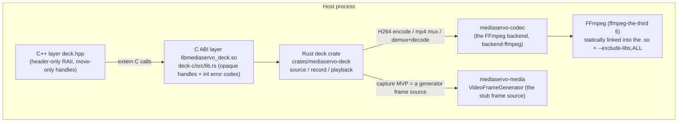

# mediaservo-deck C++ SDK Manual (Capture / Record / Playback)

> Status: active · 2026-09-23 · Living reference (for lookup). Subjects: `bindings/cxx/mediaservo-deck-cxx/include/mediaservo/deck.hpp` (header-only RAII)
> and the C ABI beneath it, `bindings/c/mediaservo-deck-c/include/mediaservo/deck.h`.
> All signatures are copied verbatim from the headers above; behavioral semantics from `bindings/c/mediaservo-deck-c/src/lib.rs`.

## 1. Positioning & Applicable Scenarios

The deck C++ binding is the **media data-plane SDK**: local camera capture → H.264/MP4 recording → file
playback decoding, one local closed loop that never touches WebRTC / a server. Applicable scenarios:

- **Local surveillance / NVR**: devices capture and record directly, no network dependency;
- **An edge-side frame source**: a unified capture entry + frame callbacks for upper layers (the field
  composed SDK, push chains);
- **A record/playback toolchain**: embedding recording and frame-by-frame decode into C++ host programs.

Not applicable: anything requiring network transport (that's link/field/client territory); audio/screen
capture currently have empty enumeration tables (see §8).

## 2. Principles & Architecture

The C++ layer is a **header-only thin wrapper** (`mediaservo-deck-cxx/src/lib.rs` is an empty carrier
crate holding only tests and distribution metadata); all implementation sinks into the C ABI cdylib
`libmediaservo_deck.so`:



Key points (all code-backed):

- **One tokio multi-thread runtime per handle (2 workers) + dedicated pump threads**: the camera pump
  thread `deck-camera-pump` polls the frame stream with a 50ms timeout while checking stop/closed flags
  (`camera_pump_loop` in lib.rs); recorder tasks spawn onto the shared runtime; the player pump thread
  `deck-player-pump` runs a synchronous `next_frame` loop.
- **The recording bridge**: `Recorder::record(camera)` is implemented in the C layer as camera pump →
  unbounded channel → the recording task (the `rec_tx` fan-out of lib.rs's `deliver_frame`); i.e. the frame
  callback and recording share one pump.
- **FrameBus interop**: a closed-loop drill exists on the Rust side (`crates/mediaservo-deck/tests/closed_loop.rs`:
  CameraSource → FrameBus publish → subscribe → Recorder), **but the C/C++ ABI face has no FrameBus entry
  point whatsoever** — C++ consumers cannot reach that capability; do not assume it exists beyond this doc.
- **Capture-backend status**: `crates/mediaservo-deck/src/source.rs`'s module header declares the MVP as a
  stub frame source (a `VideoFrameGenerator` color-bar/checker pattern); real device capture (GStreamer
  v4l2src) is a later deck version. So the current C++ face's `enumerate_devices(Camera)` only ever
  returns `["stub:test-camera"]`.

## 3. Lifecycle Sequence

The call order comes from the real example `bindings/cxx/mediaservo-deck-cxx/examples/vehicle_deck.cpp`
(L26-L92) and the C example `bindings/c/mediaservo-deck-c/examples/record_playback.c` (L33-L144):

```mermaid
sequenceDiagram
    participant App as Application (calling thread)
    participant Cam as CameraSource
    participant Pump as deck-camera-pump thread
    participant Rec as Recorder
    participant RTask as Recording task (runtime)
    participant Ply as Player

    App->>App: enumerate_devices(Camera)
    App->>Cam: open(dev_id, opts) (local initialization only)
    App->>Cam: on_frame(cb) (register; may precede start)
    App->>Cam: start() (allowed once only)
    Cam->>Pump: starts the pump thread
    loop per frame
        Pump-->>App: cb(frame) (data_* valid only inside the callback)
    end
    App->>Rec: open(path) (the parent directory must exist)
    App->>Rec: record(cam) (bridging; returns immediately)
    Rec->>RTask: spawns the recording task (H264 encode + mp4 mux)
    App->>App: ... running (the example waits for input / sleeps) ...
    App->>Rec: stop() (sets the stop signal; the loop exits within 50ms)
    App->>Rec: close() (joins the task: flush + trailer written)
    Note over App,Rec: Contract: the recorder must close before the camera
    App->>Cam: stop() (idempotent)
    App->>Cam: close() (frees the callback objects after joining the pump thread)
    App->>Ply: open(path) (demux + decoder ready)
    App->>Ply: on_frame(cb) (starts the decode pump; allowed once only)
    Ply->>Ply: the pump thread calls cb frame by frame until EOF
    App->>Ply: close() (blocks joining until EOF; cannot be aborted midway)
```

## 4. API Inventory

### 4.1 The C++ Shared Error Layer (`bindings/cxx/include/mediaservo/detail/result.hpp`)

| Item | Signature (verbatim) | Semantics |
|------|----------------------|-----------|
| Error | `struct Error { int code; std::string message; uint16_t wire_code; bool retryable; };` | `code` = `MEDIASERVO_DECK_ERR_*`; `message` read from the C layer's last_error; the deck family's `wire_code` is always 0 and `retryable` always false (filled only by client) |
| Result | `template <typename T> using Result = tl::expected<T, Error>;` | The native tl::expected API: `has_value()/value()/error()/value_or()`; calling `value()` on an error (or `error()` on ok) throws `tl::bad_expected_access<Error>` |

### 4.2 Free Functions & Types (`namespace mediaservo::deck`, deck.hpp)

| Signature (verbatim) | Semantics |
|----------------------|-----------|
| `inline Result<std::string> version()` | The SDK version `MAJOR.MINOR.PATCH` (read from the C layer's `mediaservo_deck_version`) |
| `enum class DeviceKind { Camera = 0, Audio = 1, Screen = 2 };` | Device kinds; values match the C ABI `kind` parameter |
| `struct CaptureOptions { uint32_t width = 1280; uint32_t height = 720; uint32_t framerate = 30; };` | Capture options; mapped to the C struct (all-zero fields = the C default 1280x720@30) |
| `inline std::vector<std::string> enumerate_devices(DeviceKind kind)` | Enumerates device ids (the two-call wrapper; splits on newline). **Returns an empty list on failure, with no error channel** (a `ponytail:` note in the header: the spec fixed the signature) |

### 4.3 `class CameraSource` (move-only RAII; the destructor closes; default construction = closed)

| Signature (verbatim) | Semantics / errors |
|----------------------|--------------------|
| `static Result<CameraSource> open(const std::string& dev_id, const CaptureOptions& opts = CaptureOptions{})` | Opens a camera (local initialization only). An empty `dev_id` → `INVALID_ARG`; the device not in the enumeration table → `DEVICE`; the `opts.struct_size` gate is always satisfied at the C++ layer |
| `CameraSource() noexcept` / move ctor, move assign / `~CameraSource()` | Copy deleted; moving transfers the handle and the callback registration; the destructor does `(void)close()` |
| `explicit operator bool() const noexcept` | Whether a live handle is held |
| `Result<void> start()` | Starts producing frames and the pump thread; **allowed once only**, a repeat → the C layer's `STATE`; a closed object → `INVALID_ARG, "closed"` |
| `Result<void> on_frame(detail::FrameCb cb)` (`FrameCb = std::function<void(const mediaservo_frame_t&)>`) | Registers the frame callback (fired per frame on the pump thread). Re-registering in the C layer replaces the old callback; at the C++ layer the old callback's heap object **stays alive until close** (preventing pump-thread UAF). Closed → `INVALID_ARG, "closed"` |
| `Result<void> stop() noexcept` | Stops producing frames (idempotent; a closed object returns ok directly) |
| `Result<void> close() noexcept` | Closes and frees the handle (idempotent; the callback objects are freed only after the pump thread joins) |

### 4.4 `class Recorder` (move-only RAII; the destructor closes)

| Signature (verbatim) | Semantics / errors |
|----------------------|--------------------|
| `static Result<Recorder> open(const std::string& path)` | Creates a recorder (default h264/mp4; not started). An empty path → `INVALID_ARG`; the parent directory missing → `RECORDER` (mapped from the C layer's NotFound) |
| `Result<void> record(CameraSource& camera)` | Bridge recording: the camera's frame pump → the recorder; returns immediately. A C++ closed object → `INVALID_ARG, "closed"` (the recorder check wins); at the C layer: a closed recorder/camera, a camera not started, a camera already stopped, or a duplicate record → all `STATE` |
| `Result<void> stop() noexcept` | Requests a stop (idempotent; the stop signal takes effect within 50ms; the flush happens in close) |
| `Result<void> close() noexcept` | Joins the recording task (**flush + trailer complete here**) then frees |

### 4.5 `class Player` (move-only RAII; the destructor closes)

| Signature (verbatim) | Semantics / errors |
|----------------------|--------------------|
| `static Result<Player> open(const std::string& path)` | Opens a media file (demux + decoder ready). An empty path → `INVALID_ARG`; the file missing/unsupported → `PLAYER` |
| `Result<void> on_frame(detail::FrameCb cb)` | Starts the frame-by-frame decode pump (**allowed once only**, a repeat → `STATE`; runs naturally to EOF) |
| `Result<void> close() noexcept` | **Blocks joining the decode pump until completion** (long files must wait; cannot be aborted midway — a YAGNI note in the header) |

### 4.6 The C ABI Face (`bindings/c/mediaservo-deck-c/include/mediaservo/deck.h`, signatures verbatim)

```c
mediaservo_err_t mediaservo_deck_devices_enumerate(int kind, char* out_ids, size_t cap, size_t* out_len);
mediaservo_err_t mediaservo_deck_camera_open(const char* dev_id,
                             const mediaservo_deck_capture_options_t* opts,
                             mediaservo_deck_camera_t** out);
mediaservo_err_t mediaservo_deck_camera_start(mediaservo_deck_camera_t* c);
mediaservo_err_t mediaservo_deck_camera_frames_cb(mediaservo_deck_camera_t* c, mediaservo_deck_frame_cb cb, void* user);
mediaservo_err_t mediaservo_deck_camera_stop(mediaservo_deck_camera_t* c);
mediaservo_err_t mediaservo_deck_camera_close(mediaservo_deck_camera_t* c);
mediaservo_err_t mediaservo_deck_recorder_new(const char* path, mediaservo_deck_recorder_t** out);
mediaservo_err_t mediaservo_deck_recorder_record(mediaservo_deck_recorder_t* r, mediaservo_deck_camera_t* c);
mediaservo_err_t mediaservo_deck_recorder_stop(mediaservo_deck_recorder_t* r);
mediaservo_err_t mediaservo_deck_recorder_close(mediaservo_deck_recorder_t* r);
mediaservo_err_t mediaservo_deck_player_open(const char* path, mediaservo_deck_player_t** out);
mediaservo_err_t mediaservo_deck_player_frames_cb(mediaservo_deck_player_t* p, mediaservo_deck_frame_cb cb, void* user);
mediaservo_err_t mediaservo_deck_player_close(mediaservo_deck_player_t* p);
mediaservo_err_t mediaservo_deck_last_error(char* buf, size_t len);
mediaservo_err_t mediaservo_deck_version(char* buf, size_t len);
```

Helper types (verbatim, deck.h + common.h):

```c
typedef struct mediaservo_deck_capture_options_t {
    size_t struct_size;           /* sizeof(mediaservo_deck_capture_options_t) */
    uint32_t width;               /* video width (0 = default 1280) */
    uint32_t height;              /* video height (0 = default 720) */
    uint32_t framerate;           /* frame rate (0 = default 30) */
} mediaservo_deck_capture_options_t;
#define MEDIASERVO_DECK_CAPTURE_OPTIONS_DEFAULT { sizeof(mediaservo_deck_capture_options_t), 0, 0, 0 }

typedef void (*mediaservo_deck_frame_cb)(const mediaservo_frame_t* frame, void* user);

typedef struct mediaservo_frame_t {
    uint32_t width;
    uint32_t height;
    uint64_t pts_us;        /* presentation timestamp in microseconds */
    uint32_t stride_y;
    uint32_t stride_u;
    uint32_t stride_v;
    const uint8_t* data_y;
    const uint8_t* data_u;
    const uint8_t* data_v;
} mediaservo_frame_t;
```

The `devices_enumerate` two-call convention (snprintf style): the first call with `out_ids=NULL` returns
the needed length (the return value = the length, excluding NUL; negative = an error); the second fills the
buffer and **on truncation likewise returns the needed length**; `out_len` is written back both times when
non-null. Multiple devices are newline-separated; `kind`: 0=Camera 1=Audio 2=Screen.

## 5. Usage Examples (all real in-repo code)

### 5.1 C++ Capture→Record→Playback Closed Loop (real code)

Source: `bindings/cxx/mediaservo-deck-cxx/examples/vehicle_deck.cpp` L26-L75 (excerpt; the playback section
is analogous at L78-L91; requires the env var `MEDIASERVO_RECORD_PATH`).

```cpp
auto cams = mediaservo::deck::enumerate_devices(DeviceKind::Camera);
if (cams.empty()) { std::cerr << "no camera devices\n"; return 1; }

CaptureOptions opts; // defaults to 1280x720@30
auto cam_result = CameraSource::open(cams[0], opts);
if (!cam_result) {
    std::cerr << "camera open failed: code=" << cam_result.error().code
              << " msg=" << cam_result.error().message << "\n";
    return 1;
}
auto cam = std::move(cam_result).value();

// The frame callback (pump thread; the frame pointers are valid only inside the callback — just print here, don't keep them)
auto cb = cam.on_frame([](const mediaservo_frame_t& frame) {
    std::cout << "frame " << frame.width << "x" << frame.height << "\n";
});
auto started = cam.start();

// Record (the camera must have started and live until recording ends → the recorder closes first)
auto rec = std::move(Recorder::open(out_path).value());
auto recorded = rec.record(cam);

std::cin.get();

(void)rec.stop();   // request the stop
(void)rec.close();  // close the recorder first (flush + trailer)
(void)cam.stop();   // close the camera after
(void)cam.close();
```

### 5.2 C++ Error Paths & Closed Semantics (real code)

Source: `bindings/cxx/mediaservo-deck-cxx/tests/test_deck.cpp` L35-L55.

```cpp
// Empty dev_id → the C ABI fails fast with INVALID_ARG, hardware untouched
auto r = CameraSource::open("");
assert(!r.has_value());
assert(r.error().code == MEDIASERVO_DECK_ERR_INVALID_ARG);
assert(!r.error().message.empty());

// A closed camera: start/on_frame → INVALID_ARG/"closed"
CameraSource c;
assert(!c);
auto st = c.start();
assert(st.error().code == MEDIASERVO_DECK_ERR_INVALID_ARG);
assert(st.error().message == "closed");
assert(c.stop().has_value());  // idempotent
assert(c.close().has_value()); // idempotent (C++ layer; a repeated C-layer close on the same pointer is UB)
```

### 5.3 C ABI Consumption (real code, excerpt)

Source: `bindings/c/mediaservo-deck-c/examples/record_playback.c` L39-L58, L94-L118.

```c
/* 1. Enumerate cameras (two-call pattern: first the length, then the content) */
size_t need = 0;
mediaservo_err_t rc = mediaservo_deck_devices_enumerate(0, NULL, 0, &need);
char dev[64];
rc = mediaservo_deck_devices_enumerate(0, dev, sizeof(dev), &need);

/* 2. Open the camera + start producing frames (default 1280x720@30) + the frame callback */
mediaservo_deck_capture_options_t copts = MEDIASERVO_DECK_CAPTURE_OPTIONS_DEFAULT;
mediaservo_deck_camera_t* cam = NULL;
rc = mediaservo_deck_camera_open(dev, &copts, &cam);
rc = mediaservo_deck_camera_start(cam);
rc = mediaservo_deck_camera_frames_cb(cam, on_camera_frame, NULL);

/* 4. Stop recording + close (order: recorder before camera — the lifecycle contract) */
rc = mediaservo_deck_recorder_stop(rec);
rc = mediaservo_deck_recorder_close(rec);
rc = mediaservo_deck_camera_stop(cam);
rc = mediaservo_deck_camera_close(cam);
```

Every C-side error branch follows one pattern: `rc != MEDIASERVO_OK` →
`mediaservo_deck_last_error(err, sizeof(err))` fetches the details.

## 6. Error & Boundary Semantics

### 6.1 Error Codes (verbatim from deck.h)

```c
#define MEDIASERVO_DECK_ERR_INVALID_ARG  (-1)   /* invalid args / null pointer / struct_size too small */
#define MEDIASERVO_DECK_ERR_DEVICE       (-2)   /* device enumeration/open failure */
#define MEDIASERVO_DECK_ERR_RECORDER     (-3)   /* the record domain (missing path, mux failure, etc.) */
#define MEDIASERVO_DECK_ERR_PLAYER       (-4)   /* the playback domain (missing file, demux/decode failure, etc.) */
#define MEDIASERVO_DECK_ERR_STATE        (-5)   /* a state violation (duplicate start, record before start, etc.) */
#define MEDIASERVO_DECK_ERR_INTERNAL     (-6)   /* an internal error (incl. panic capture, poisoned mutex) */
```

Rust `DeckError` → C codes are mapped by the call domain (`map_deck_err` in lib.rs): `Device`→-2,
`InvalidState`→-5, `NotFound`/`Codec`/`Io` map to -2/-3/-4 per the Camera/Recorder/Player context
(Camera's Codec/Io → -6); unknown variants are uniformly -6. All exported functions are wrapped in
`catch_unwind`; panics never cross the FFI.

### 6.2 The last_error Channel

- `mediaservo_deck_last_error(buf, len)` is thread-safe; returns an empty string when there is no error;
  overlong values are truncated + NUL.
- **A process-global single slot** (`static LAST_ERROR`): any thread's any failing call overwrites it. Under
  concurrent consumption (or concurrent test cases) "call first, read the error later" is not an atomic pair —
  the deck-c tests themselves serialize with a file-local `TEST_LOCK` for exactly this reason (a note in
  lib.rs's test module; the same family as link-c/field-c). Consumers writing tests that concurrently assert
  last_error must serialize themselves.

### 6.3 The struct_size Compatibility Gate

`mediaservo_deck_camera_open` validates `opts->struct_size >= sizeof(mediaservo_deck_capture_options_t)`
(currently 24B on 64-bit); too small → `INVALID_ARG` with a "rebuild with current header" hint; an oversized
value is ignored — struct evolution doesn't break binary compatibility (review R3). The C++ layer
initializes with `MEDIASERVO_DECK_CAPTURE_OPTIONS_DEFAULT`, always satisfied.

### 6.4 Lifecycle Red Lines (the C header contract, translated by the C++ layer into RAII guarantees)

| Red line | Consequence of violation |
|----------|--------------------------|
| Using a handle after close (incl. a repeated close on the same pointer) | UB at the C layer (the C++ layer wraps it as idempotent + default-construction=closed) |
| Calling any `mediaservo_deck_*` API inside a frame callback (incl. close) | UB (the pump thread waits on/frees itself) |
| Holding the `data_y/u/v` pointers after the callback returns | dangling — copy if you need to keep |
| Closing the recorder after the camera | the recording task holds the camera's frame bridge; closing out of order is out-of-contract behavior |
| record before the camera starts (or after it stopped) | `STATE` (the C layer explicitly checks the started/stopped flags) |
| Calling player `on_frame` twice | `STATE` (allowed once only) |

## 7. Build & Linking

### 7.1 Direct Compilation (the actual form in the in-repo test script)

Source: `scripts/test-cxx.sh` (the deck pass). Prerequisite: `pixi run build-c` producing
`target/debug/libmediaservo_deck.so`.

```bash
g++ -std=c++11 -Wall -Wextra \
    -I bindings/cxx/mediaservo-deck-cxx/include -I bindings/cxx/include \
    -I bindings/c/mediaservo-deck-c/include -I bindings/c/include \
    bindings/cxx/mediaservo-deck-cxx/tests/test_deck.cpp \
    -L target/debug -lmediaservo_deck -o /tmp/opencode/test_deck_cxx
LD_LIBRARY_PATH=$PWD/target/debug /tmp/opencode/test_deck_cxx
```

(The compile line in the header comments is likewise a `-std=c++17` form, see the deck.hpp test-header L2-L3
notes; the binding body itself is C++11-baseline.)

### 7.2 Consuming the Installed Tree (after deploy bindings)

`mediaservo.sh deploy bindings --prefix <dir>` assembles `lib/ + include/mediaservo + pkgconfig + cmake`
(the common C header and per-sdk headers, and the cxx .hpp files, all flattened into `include/mediaservo/`).

**CMake** (`bindings/c/cmake/mediaservoConfig.cmake.in`; one package, multiple components, the OpenCV/Boost
convention; the two consumption snippets below are derived from the template — hypothetical, not
compile-verified):

```cmake
find_package(mediaservo REQUIRED COMPONENTS deck)
target_link_libraries(app PRIVATE mediaservo::deck)   # INTERFACE: include/ + libmediaservo_deck.so
```

A missing/unknown component → `FATAL_ERROR`; version compatibility is gated by
`mediaservoConfigVersion.cmake` (`@VERSION@/@MAJOR@`).

**pkg-config** (`bindings/c/mediaservo-deck-c/mediaservo-deck.pc.in`):

```bash
pkg-config --cflags --libs mediaservo-deck
# Libs: -L${libdir} -lmediaservo_deck    Cflags: -I${includedir}
```

### 7.3 Runtime Dependencies (FFmpeg)

- **FFmpeg is statically linked into `libmediaservo_deck.so`** (an R10 note in
  `bindings/c/mediaservo-deck-c/build.rs`: ffmpeg-the-third built from source +
  `-Wl,--exclude-libs,ALL`): the host needs no system FFmpeg, and it doesn't conflict with the host's own
  other FFmpeg versions (static symbols never enter the dynamic symbol table).
- soname (Linux only): the real file `libmediaservo_deck.so.MAJOR.MINOR.PATCH`, the soname
  `libmediaservo_deck.so.<MAJOR>`; when deploying to a different machine, carry the real file rather than
  just symlinks, and point `LD_LIBRARY_PATH` or rpath at `lib/`.
- The `.pc` file has no FFmpeg `Requires` — consistent with the static embedding; expected, not an omission.

## 8. Known Pitfalls / FAQ

- **Q: No real camera enumerated?** That is the current state: capture MVP is a stub frame source (the
  `crates/mediaservo-deck/src/source.rs` module header); the Camera enumeration table is fixed to
  `stub:test-camera`, and Audio/Screen are always empty. Real v4l2 capture is a later deck version.
- **Q: The recorder open returns -3?** The C layer's `Recorder::new` requires **the parent directory to
  already exist** (no implicit mkdir; an explicit-failure design in record.rs); `mkdir -p` first.
- **Q: The recorded mp4 won't open / has 0 frames?** The data is only complete after `recorder_close()`
  (joining the task completes flush+trailer); `stop()` merely signals. Also mind the close order
  recorder → camera (§6.4).
- **Q: The player close hangs?** That is the semantics: a blocking join to EOF — long files must finish;
  there is no abort interface (a YAGNI note in the header). To stop while decoding, count frames in the
  callback yourself and stop consuming (the pump still runs to the end).
- **Q: Is an empty `enumerate_devices` an error or no devices?** Indistinguishable (no Result channel; a
  `ponytail:` note in the header). To distinguish errors, drop to the C ABI's two-call pattern and check the
  return value.
- **Q: The frame callback receives no frames?** Check whether you `open`ed but forgot `start()` (callback
  registration doesn't depend on start, but frame production does); also the pump thread's 50ms polling
  cadence — after stop/close it exits within 50ms, and the last frame may be dropped.
- **Q: Concurrent tasks reading last_error cross-contaminate?** Yes, a global single slot (§6.2).
- **Unverified**: `deck.hpp` L37-L38 has a dangling doc comment + a stray `;` (error-detail explanatory text
  stranded at namespace top level with no corresponding declaration) — it doesn't affect compilation (the
  tests pass under `-Wall -Wextra`); likely a refactor leftover; when citing that comment, defer to §4.1's
  `Error` struct (result.hpp).

## 9. Related File Index

| Content | Path |
|---------|------|
| The C++ header (this manual's subject) | `bindings/cxx/mediaservo-deck-cxx/include/mediaservo/deck.hpp` |
| The C ABI header | `bindings/c/mediaservo-deck-c/include/mediaservo/deck.h` |
| Shared C types | `bindings/c/include/mediaservo/common.h` |
| Shared C++ Result | `bindings/cxx/include/mediaservo/detail/result.hpp` |
| C ABI impl + unit tests | `bindings/c/mediaservo-deck-c/src/lib.rs` |
| The C++ compile-and-run test | `bindings/cxx/mediaservo-deck-cxx/tests/test_deck.cpp` |
| The C++ closed-loop example | `bindings/cxx/mediaservo-deck-cxx/examples/vehicle_deck.cpp` |
| The C closed-loop example | `bindings/c/mediaservo-deck-c/examples/record_playback.c` |
| The Rust deck crate | `crates/mediaservo-deck/` (source/record/playback/error) |
| CMake/pkg-config templates | `bindings/c/cmake/mediaservoConfig.cmake.in` · `bindings/c/mediaservo-deck-c/mediaservo-deck.pc.in` |
| The C++ test driver script | `scripts/test-cxx.sh` |
