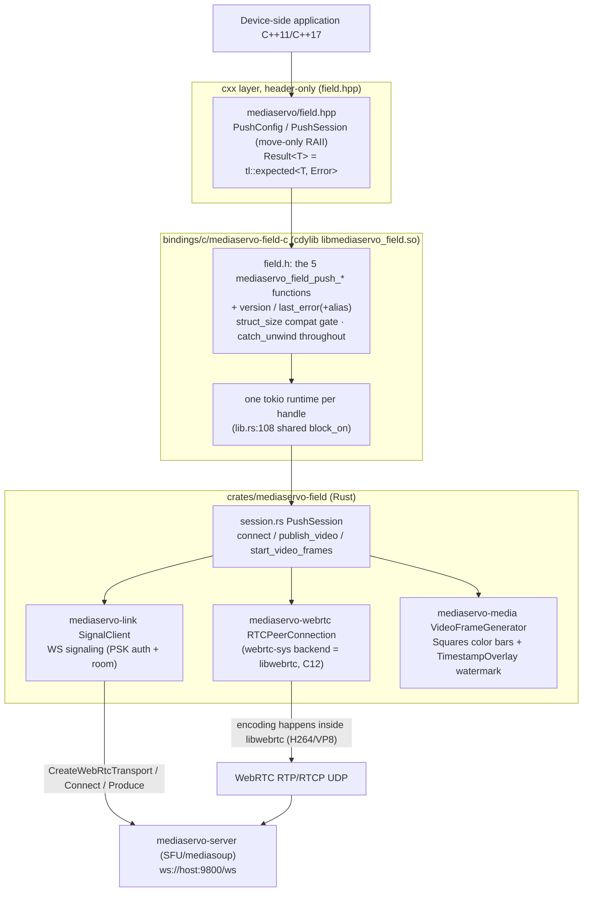
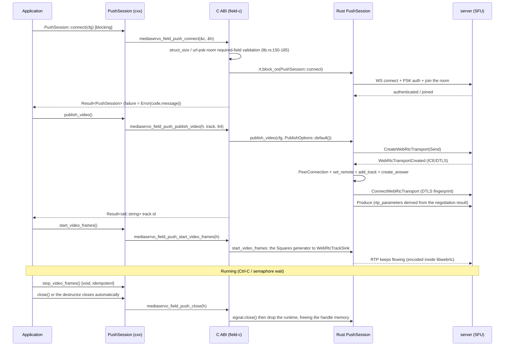

# MediaServo field C++ SDK Manual (Device-Side Push Closed Loop: Signaling + WebRTC + Built-In Frame Source)

> Status: active · 2026-09-23 · Source of truth = `bindings/cxx/mediaservo-field-cxx/include/mediaservo/field.hpp`
> and `bindings/c/mediaservo-field-c/include/mediaservo/field.h` (7 main functions + 1 deprecated alias; cross-checked name by name)
> Underlying behavior defers to the measured sources `bindings/c/mediaservo-field-c/src/lib.rs` and `crates/mediaservo-field/src/session.rs`.

## 1. Positioning & Applicable Scenarios

`mediaservo::field` (a C++ header-only RAII binding over the `mediaservo_field_*` C ABI; on the Rust side
the `mediaservo-field` crate) is the **composed SDK: one session packages the "signaling + WebRTC push"
closed loop** — the device side (vehicle/camera) connects to mediaservo-server (or via the host-agent local
gateway), publishes one video track, and keeps pushing frames.

Boundaries against the sibling SDKs (link = the IPC foundation, deck = the capture/codec toolbox,
client = the consumer side):

| Scenario | Usage |
|----------|-------|
| Vehicle/device pushing to the SFU, cockpit/browser pulling | `PushSession::connect` → `publish_video` → `start_video_frames` (all in this SDK) |
| Demo/bring-up/placeholder streams (Squares color bars + timestamp watermark) | `start_video_frames` has a built-in synthetic frame source; streams without any external input |
| Third-party C/C++ device integration | the C ABI (`field.h`) or this header-only C++ face; a single .so dependency |

**Not applicable (the true boundary of this binding face, see §8)**: injecting real camera frames (the
C/C++ face has no frame-writing API; the built-in source is synthetic Squares; real-frame pushing goes
through Rust `mediaservo-field`'s `video_sender()` escape hatch or the host binary), pulling (the Rust
crate has `PullSession`, not exported on the C/C++ face), multi-stream video (the Rust MVP is single-track,
session.rs:133-137), control DataChannels (in the `mediaservo::client` / host controller domain).

## 2. Principles & Architecture

Three layers: the C++ RAII thin layer (header-only, zero compilation) → the stable C ABI face (opaque
handles + int error codes + the struct_size gate) → the Rust `mediaservo-field` crate (dependency direction
`field → webrtc + link + deck`, lib.rs:8, C21 one-way acyclic). Each handle embeds a shared multi-thread
tokio runtime (worker_threads=2, lib.rs:129-135); every C call `block_on`s the same instance — the WS read
loop and other background tasks live on it (review R1: a per-call runtime would cancel tasks on return,
killing the session).



Key points (source-verified):

- **The encoder is not a separate stage**: frames are fed as I420 into the `WebRtcTrackSink` (session.rs:339);
  encoding happens inside libwebrtc per the negotiation result; bitrate/fps are configured via
  `set_encoding_bitrate` / `set_encoding_framerate` (session.rs:222-229).
- **Negotiation goes the answerer path**: the server-side SDP is the remote offer; this end calls
  `create_answer` (session.rs:166-215, the C18 official path); the codec is fixed on the C face to
  `PublishOptions::default()` = **vp8** + encoder_backend auto (config.rs:177-184, lib.rs:259).
- **The Rust side's rich config is not lowered to the C face**: `role`/`gateway_src`/`min_bitrate_kbps`/
  `degradation`/`content_hint` (config.rs:77-106) cannot be set from the C/C++ bindings; the C-face connect
  uses `PushConfig::new` (role=Host, direct to the server, config.rs:110-126).
- **Session events are dropped on the C face**: Rust `connect` returns `(session, events)`; the C layer
  destructures it as `Ok((session, _events))` (lib.rs:206) — disconnects/server errors are invisible to
  C/C++ consumers (§8 open item).

## 3. Lifecycle Sequence

The call order comes from `bindings/cxx/mediaservo-field-cxx/examples/vehicle_field.cpp` (full text) and
`bindings/c/mediaservo-field-c/examples/vehicle_push.c` (L14-73).



## 4. API Inventory

### 4.1 The C ABI (`bindings/c/mediaservo-field-c/include/mediaservo/field.h`)

Signatures copied verbatim from the header (line numbers = field.h). Error convention: `mediaservo_err_t`
(int), 0=OK, <0=error (common.h:23-24); error details read via `mediaservo_field_last_error`.

| Function | Header line | Semantics |
|----------|-------------|-----------|
| `mediaservo_err_t mediaservo_field_push_connect(const mediaservo_push_config_t* cfg, mediaservo_field_push_t** out)` | L69 | Connects signaling + creates the session (**blocking**). On success `*out` = a new handle (the caller must close); on failure `*out` stays null |
| `mediaservo_err_t mediaservo_field_push_publish_video(mediaservo_field_push_t* s, char* out_track, size_t out_track_len)` | L72 | Publishes the video track (blocking negotiation). The track id is written into `out_track` (64+ bytes recommended; overlong is truncated + NUL, lib.rs:263) |
| `mediaservo_err_t mediaservo_field_push_start_video_frames(mediaservo_field_push_t* s)` | L75 | Starts the built-in frame generation (Squares + timestamp watermark). publish_video first; a repeat call = ERR_STATE |
| `void mediaservo_field_push_stop_video_frames(mediaservo_field_push_t* s)` | L78 | Stops frame generation (**idempotent**; void with no error channel; a null handle is a silent no-op, lib.rs:328-330) |
| `mediaservo_err_t mediaservo_field_push_close(mediaservo_field_push_t* s)` | L81 | Closes the session **and frees the handle** (null gives OK, lib.rs:350; a second call on the same pointer = UB, see §8-1) |
| `mediaservo_err_t mediaservo_field_last_error(char* buf, size_t len)` | L86 | The most recent error details (process-level, §6.2; an empty string when no error) |
| `mediaservo_err_t mediaservo_last_error(char* buf, size_t len)` | L89 | A **deprecated alias** of the above (kept additive-only; do not use in new code) |
| `mediaservo_err_t mediaservo_field_version(char* buf, size_t len)` | L92 | The SDK version MAJOR.MINOR.PATCH (= the crate version, currently 0.1.1) |

**Config struct** (field.h:49-61):

```c
typedef struct mediaservo_push_config_t {
    size_t struct_size;           /* required sizeof(mediaservo_push_config_t) — the ABI compat gate */
    const char* url;              /* the WS signaling address, e.g. "ws://host:9800/ws" (required) */
    const char* psk;              /* the PSK auth key (required) */
    const char* room;             /* the room ID (required) */
    uint32_t width;               /* video width (default 1280) */
    uint32_t height;              /* video height (default 720) */
    uint32_t framerate;           /* frame rate (default 30) */
    uint32_t bitrate_kbps;        /* encode bitrate kbps (default 2000) */
    uint64_t keyframe_interval;   /* keyframe interval in seconds (default 2) */
} mediaservo_push_config_t;
#define MEDIASERVO_PUSH_CONFIG_DEFAULT { sizeof(mediaservo_push_config_t), NULL, NULL, NULL, 1280, 720, 30, 2000, 2 }
```

Semantic details (lib.rs evidence): `struct_size` smaller than the current struct gives INVALID_ARG with a
rebuild hint (lib.rs:155-162); larger (future tail appends) and the extra bytes are ignored. width/height/
framerate/bitrate_kbps/keyframe_interval set to **0 = keep the Rust defaults** (lib.rs:188-202). Non-UTF-8
strings give INVALID_ARG (lib.rs:181-184).

**Error codes** (field.h:33-37; the historical FIELD-less aliases at L39-43 keep the same values):

| Macro | Value | Trigger (implementation face) |
|-------|-------|-------------------------------|
| `MEDIASERVO_FIELD_ERR_INVALID_ARG` | -1 | null args / struct_size too small / missing required fields / invalid UTF-8; calling on a closed cxx session |
| `MEDIASERVO_FIELD_ERR_CONNECT` | -2 | signaling connect failure (WS/auth/room join) |
| `MEDIASERVO_FIELD_ERR_PUBLISH` | -3 | publish_video negotiation/Produce failure |
| `MEDIASERVO_FIELD_ERR_STATE` | -4 | C face: the handle has the closed flag / started before publishing / a duplicate start (lib.rs:243-245, 293-295, 314) |
| `MEDIASERVO_FIELD_ERR_INTERNAL` | -5 | a panic backstop (catch_unwind) / a poisoned lock |

**Thread safety**: the handle contract is **single-thread ownership** (field.h:18); the implementation's
internal Mutex + `unsafe impl Send/Sync` (lib.rs:113-116) allows cross-thread transfer but calls still
serialize on the Mutex; no promise is made about concurrent calls on the same handle. All exported
functions keep panics from crossing the FFI boundary (wrapped in catch_unwind).

### 4.2 The C++ Layer (`bindings/cxx/mediaservo-field-cxx/include/mediaservo/field.hpp`, header-only)

Namespace `mediaservo::field`. `Result<T>` = `tl::expected<T, mediaservo::Error>`
(detail/result.hpp:48) — native API `has_value()/value()/error()/value_or()`, **no operator bool**
(result.hpp:4); calling `value()` on an error result throws `tl::bad_expected_access<Error>`
(result.hpp:5-6). `Error{code, message, wire_code, retryable}`; the field family hardcodes
`wire_code=0 / retryable=false` (result.hpp:28-32).

```cpp
/// The SDK version (MAJOR.MINOR.PATCH).                       // field.hpp:55
inline Result<std::string> version();

/// Push config (corresponds to mediaservo_push_config_t).     // field.hpp:65
struct PushConfig {
    std::string url;  std::string psk;  std::string room;
    uint32_t width = 1280;  uint32_t height = 720;  uint32_t framerate = 30;
    uint32_t bitrate_kbps = 2000;  uint64_t keyframe_interval = 2;
};

/// The push session (move-only RAII; the destructor closes; default construction = closed).  // field.hpp:77
class PushSession {
public:
    static Result<PushSession> connect(const PushConfig& cfg);  // L80 blocking; returns an error rather than throwing
    PushSession() noexcept = default;                           // L100 = a closed session
    ~PushSession();                                             // L101 (void)close()
    PushSession(const PushSession&) = delete;                   // L103 non-copyable
    PushSession& operator=(const PushSession&) = delete;        // L104
    PushSession(PushSession&& other) noexcept;                  // L105
    PushSession& operator=(PushSession&& other) noexcept;       // L106 self-assignment safe; closes the old value first
    explicit operator bool() const noexcept;                    // L115 whether a live session is held
    Result<std::string> publish_video();                        // L118 returns the track id on success
    Result<void> start_video_frames();                          // L129
    void stop_video_frames() noexcept;                          // L139 idempotent, no error channel
    Result<void> close() noexcept;                              // L144 nulls h_; a repeat call returns OK
};
```

RAII semantics (field.hpp header comments L4-9 + the implementation): every method on a
default-constructed/null handle **never touches the C ABI**, returning
`Error{MEDIASERVO_FIELD_ERR_INVALID_ARG, "closed"}` directly (L119, L130); after a move the source object
becomes null (`release_()`, L156-160); destruction is safe on both closed and default objects. Empty-string
config fields are passed as nullptr to C (`c_str_or_null`, L44-46), and the C face rejects them as missing.

## 5. Usage Examples

### 5.1 Complete C++ Push (real example; credentials injected via env)

Source: `bindings/cxx/mediaservo-field-cxx/examples/vehicle_field.cpp` L10-59 (a skeleton excerpt, line by
line against the original; the compile command is in that file's L2-3 comment and section 7).

```cpp
int main() {
    using mediaservo::field::PushConfig;
    using mediaservo::field::PushSession;

    // Config read from env vars (hardcoded keys/addresses forbidden)
    const char* url = std::getenv("MEDIASERVO_SIGNAL_URL");
    const char* psk = std::getenv("MEDIASERVO_PSK");
    const char* room = std::getenv("MEDIASERVO_ROOM");
    if (!url || !psk || !room) {
        std::cerr << "set MEDIASERVO_SIGNAL_URL / MEDIASERVO_PSK / MEDIASERVO_ROOM\n";
        return 1;
    }

    PushConfig cfg;
    cfg.url = url;  cfg.psk = psk;  cfg.room = room;

    auto session = PushSession::connect(cfg);
    if (!session) {
        std::cerr << "connect failed: code=" << session.error().code
                  << " msg=" << session.error().message << "\n";
        return 1;
    }
    auto s = std::move(session).value();

    auto track = s.publish_video();
    if (!track) { std::cerr << "publish failed\n"; return 1; }
    std::cout << "published track: " << track.value() << "\n";

    auto started = s.start_video_frames();
    if (!started) { std::cerr << "start frames failed\n"; return 1; }

    std::cout << "pushing frames (Ctrl-C to stop)...\n";
    std::cin.get(); // blocks until the user stops

    s.stop_video_frames();
    (void)s.close();
    return 0;
}
```

### 5.2 The Equivalent C ABI Flow

Source: `bindings/c/mediaservo-field-c/examples/vehicle_push.c` L14-73 (that example hardcodes
`ws://127.0.0.1:9800/ws` as a dev value; inject per the header's L8-16 usage for production).

```c
mediaservo_push_config_t cfg = MEDIASERVO_PUSH_CONFIG_DEFAULT;
cfg.url = "ws://127.0.0.1:9800/ws";  cfg.psk = "mediaservo-dev";  cfg.room = "vehicle-c";

mediaservo_field_push_t* s = NULL;
char err[256];
if (mediaservo_field_push_connect(&cfg, &s) != MEDIASERVO_OK) {
    mediaservo_field_last_error(err, sizeof(err));
    fprintf(stderr, "connect failed: %s\n", err);
    return 1;
}
char track[64];
mediaservo_field_push_publish_video(s, track, sizeof(track));   /* per-step rc checks omitted; see the original */
mediaservo_field_push_start_video_frames(s);
/* ... run ... */
mediaservo_field_push_stop_video_frames(s);
mediaservo_field_push_close(s);   /* from here s dangles; never reuse it (see 8-1) */
```

### 5.3 Error Paths / RAII Semantics Regression Anchors (tests as docs)

Source: `bindings/cxx/mediaservo-field-cxx/tests/test_field.cpp` — 5 cases: the version prefix (L15-19),
an empty config failing fast with INVALID_ARG without touching the network (L21-28), `value()` misuse
throwing `bad_expected_access` (L30-40), the behaviors of every method on a closed session (L42-58:
publish/start=INVALID_ARG+"closed", stop no-op, close idempotent OK), and move semantics (L60-70).

## 6. Errors & Boundaries

### 6.1 The Error Channel's Three-Layer Shape

1. **C**: a `<0` return value + `mediaservo_field_last_error` for details (overwritten on every failed C call).
2. **C++**: `Result<T>` (not exceptions); `detail::make_error(code)` automatically reads last_error after a
   C call returns <0 and assembles `Error{code, message}` (field.hpp:37-41, a 512B buf).
3. **One exception only**: misusing `value()/error()` throws `tl::bad_expected_access<Error>` —
   a programming-error signal, not a runtime error channel (consistent with livekit's Result pattern, field.hpp:8-9).

### 6.2 last_error = Process-Global (not thread-local, not per-handle)

Implemented as `static LAST_ERROR: Mutex<Option<String>>` (lib.rs:48). **Thread-safe** means concurrent
reads/writes do not data-race (the Mutex serializes); but the semantics are **the most recent error in the
whole process**: under multi-thread/multi-handle, what thread A reads may be the error thread B just wrote.
The reliable pattern: read the message **immediately** on the same thread after a failure (the cxx layer's
make_error is exactly this shape). The Rust test face therefore serializes the whole file (TEST_LOCK,
lib.rs:424-429) — consumers likewise should not rely on last_error for concurrent attribution.

### 6.3 The struct_size ABI Gate (R3)

`cfg.struct_size` must be `>= sizeof(mediaservo_push_config_t)` (the current struct); callers compiled
against an old header get an explicit INVALID_ARG + the "rebuild with current header" text (lib.rs:155-162);
an oversized value (future struct evolution) ignores the tail. Within a MAJOR, fields are only added, never
re-semantics'd (D241, field.h:3). The cxx layer fills it correctly via the `MEDIASERVO_PUSH_CONFIG_DEFAULT`
initialization.

### 6.4 Other Boundaries

- **Blocking semantics**: connect/publish_video block until the signaling round-trip completes; start/stop/
  close are local operations only (the start comment at lib.rs:282 says "blocking only for the local
  startup"). No timeout parameter — the hang behavior when the server is unreachable depends on the
  underlying WS connection phase (no explicit timeout set; a device-day observation item).
- **Single video track**: a second `publish_video` returns ERR_PUBLISH (the Rust side's InvalidState
  "an active track already exists", session.rs:133-137).
- **start precondition**: starting before publishing gives ERR_STATE ("publish_video first", session.rs:318).
- **After close**: all other C-face calls are UB (the handle memory is freed; see 8-1); the cxx face is safe
  because h_ is nulled.
- **Panics never cross the boundary**: every C entry is wrapped in catch_unwind → ERR_INTERNAL (the tail of
  each lib.rs function).

## 7. Build & Linking

Prerequisite: the cdylib is built (`pixi run build-c` → `target/debug/libmediaservo_field.so` +
the `.so.0` dev symlink, the test-cxx.sh L4 comment).

### 7.1 Direct In-Repo Compilation (the unified four-SDK form, from scripts/test-cxx.sh L13-18)

```bash
g++ -std=c++11 -Wall -Wextra \
    -I bindings/cxx/mediaservo-field-cxx/include -I bindings/cxx/include \
    -I bindings/c/mediaservo-field-c/include -I bindings/c/include \
    bindings/cxx/mediaservo-field-cxx/tests/test_field.cpp \
    -L target/debug -lmediaservo_field -o /tmp/opencode/test_field_cxx
LD_LIBRARY_PATH=target/debug /tmp/opencode/test_field_cxx
```

C++11 baseline (Result uses tl::expected; no C++17 dependency); `bindings/cxx/include` provides the shared
`detail/result.hpp` + the vendored `tl/expected.hpp`. The C example is the same shape (the vehicle_push.c
L3-6 comment). The regression entry: `bash scripts/test-cxx.sh` (the field/link/deck/client four SDKs +
the common-cxx contract).

### 7.2 Consuming the Delivery Tree (out/bindings / the sdk-field package)

`./msrtc.sh build bindings` (or the submodule's `mediaservo.sh build bindings` / `deploy bindings`)
assembles `out/bindings/`: `include/mediaservo/{field.h,field.hpp,common.h,detail/,3rdparty/}`
(mediaservo_cli.py L412-426 copies each sdk's `.h`/`.hpp`), `lib/libmediaservo_field.so.<major>`,
`lib/pkgconfig/mediaservo-field.pc`, `lib/cmake/mediaservo/mediaservoConfig.cmake`.

```cmake
find_package(mediaservo REQUIRED COMPONENTS field)   # the D248 discovery face
target_link_libraries(app PRIVATE mediaservo::field)
```

```bash
pkg-config --cflags --libs mediaservo-field   # -I${prefix}/include -L${prefix}/lib -lmediaservo_field
```

The .pc template: `bindings/c/mediaservo-field-c/mediaservo-field.pc.in` (relocatable via `${pcfiledir}`).
Release-package ownership: **field goes in the sdk-field package** (the device half, `sdk_list = "field link deck"`);
when the sdk-client package assembles, field's h/hpp/pc/.so are explicitly stripped (mediaservo_cli.py
L1233-1245) — cockpit consumers don't need this SDK.

## 8. Known Pitfalls / FAQ / Open Items

1. **The C face's "idempotent" close holds only for a null pointer** (a header-comment vs implementation
   divergence, field.h:81 vs lib.rs:353): `mediaservo_field_push_close` first does `Box::from_raw(s)`
   reclaiming ownership; by function return the handle memory **is already freed**; a second close on the
   same pointer is `Box::from_raw` on a dangling pointer = a double-free UB. The internal `closed.swap`
   flag only guards the "call other APIs after close" path, not a second close itself.
   **Correct usage**: on the C face, set `s = NULL` immediately after close; or just use the cxx
   `PushSession` (close nulls h_; both destruction and repeated close are safe — test_field.cpp L56-57 and
   L69 are the regression anchors for this semantics).
2. **No event notification face**: the Rust session has `SessionEvents` (disconnects/server errors escalate
   to SessionEvent::Error, session.rs:86-110), but the C layer directly discards `_events` (lib.rs:206).
   C/C++ consumers **cannot perceive a disconnect** after `start_video_frames` — push-side deployments need
   their own health check (pull-side bytes liveness, or the server admin API); reconnecting after a
   disconnect = rebuilding the whole session. A callback face is a potential evolution item (not yet chartered).
3. **The codec is not selectable**: the C face's publish_video fixes `PublishOptions::default()` → **VP8**
   (lib.rs:259 + config.rs:180). To push H264, use the Rust crate or wait for the C face to grow parameters
   (the struct_size gate has already paved the way for tail appends).
4. **The built-in frame source is synthetic**: `start_video_frames` = Squares color bars + a timestamp
   watermark (session.rs:326-345), not a real camera capture. There is **no API** on this binding face to
   attach a real video source — the Rust escape hatch is `video_sender()` + `write_raw_i420_with_ts`
   (session.rs:306-309, the host-streamer consumption form); C/C++ consumers needing real frames should
   evaluate using the host binary directly or file a C-face parameter-extension request.
5. **last_error is process-global** (§6.2): with multiple handles/threads failing concurrently, error details
   overwrite each other; the code return value itself is reliable; treat the message as diagnostic only.
6. **One tokio runtime per handle (2 worker threads)**: multi-stream push = multiple handles = linear thread
   growth; imperceptible for the vehicle-side single-session scenario, but watch it in dense gateway
   scenarios (the upgrade path = a shared runtime; not chartered).
7. **Stale Rust doc comments**: lib.rs:16's module comment writes the publish_video signature as
   `mediaservo_track_id_t* out_track`, mismatching the current header (`char*, size_t`, field.h:72) —
   the header is authoritative (the hand-maintained field.h is the exported face's source of truth).
8. **The version face**: `mediaservo_field_version` returns mediaservo-field-c's CARGO_PKG_VERSION
   (lib.rs:412) = the workspace-inherited value (currently 0.1.1); the delivery crate mediaservo-field has
   an independent version source (F12/V1a, crates/mediaservo-field/Cargo.toml:3) — the two currently share
   a value but are **semantically independent**; do not infer the Rust crate's version from the C face's.
9. **Open item (unverified)**: the C face's connect has no explicit timeout parameter; the blocking ceiling
   for a half-reachable server (TCP open, WS handshake hanging) is unpinned; retest during the device-day /
   weak-network matrix reruns (the weaknet degraded profile is ready).

---

### Appendix: Source-of-Truth Inventory (grep anchors for every symbol in this doc)

| Face | File | Key lines |
|------|------|-----------|
| C header | bindings/c/mediaservo-field-c/include/mediaservo/field.h | functions L69/72/75/78/81/86/89/92; struct L49-61; error codes L33-43 |
| C impl | bindings/c/mediaservo-field-c/src/lib.rs | connect L145 / publish L232 / start L284 / stop L326 / close L348 / last_error L393 / alias L400 / version L407; LAST_ERROR L48; runtime L129 |
| C++ header | bindings/cxx/mediaservo-field-cxx/include/mediaservo/field.hpp | version L55 / PushConfig L65 / PushSession L77-162 |
| Result | bindings/cxx/include/mediaservo/detail/result.hpp | Error L33-43 / Result L48 |
| Rust behavior | crates/mediaservo-field/src/session.rs · config.rs · sfu.rs | PushSession L60-370 / PublishOptions L170-184 / codec_spec sfu.rs:22 |
| Examples/tests | test_field.cpp (cxx) · vehicle_field.cpp (cxx) · vehicle_push.c (c) | the references in section 5 |
| Build | scripts/test-cxx.sh · mediaservo-field.pc.in · scripts/mediaservo_cli.py L412-426/L1233-1254 | section 7 |
