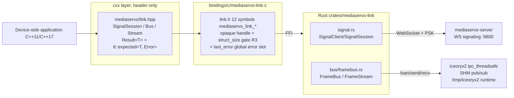
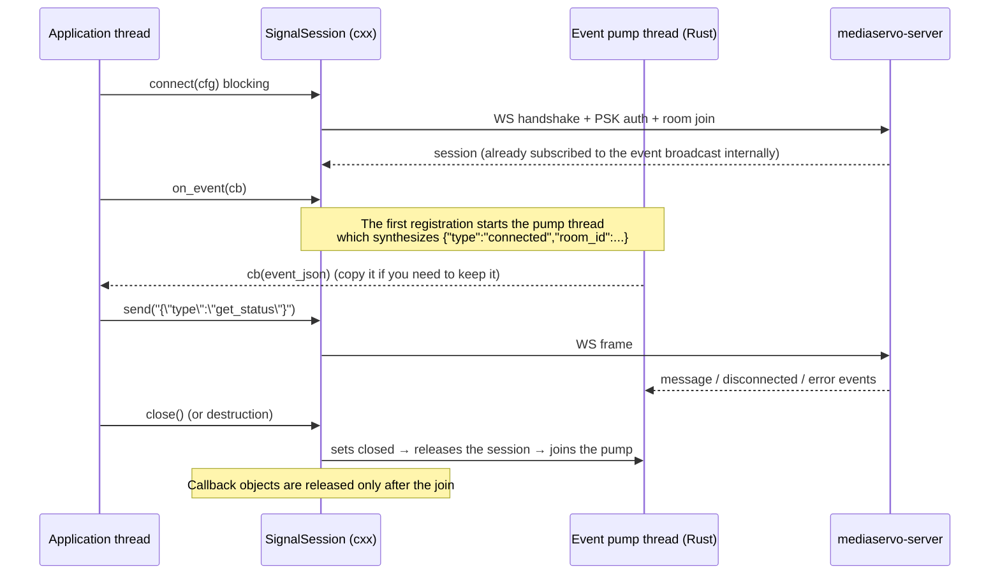
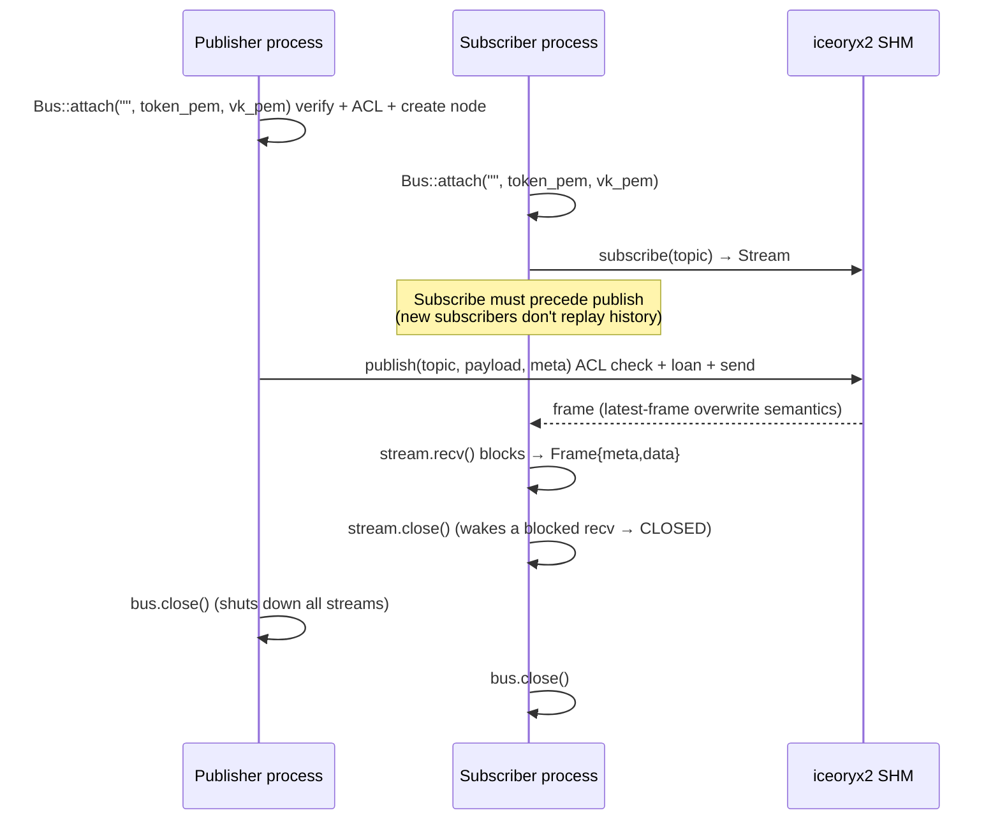

# MediaServo link C++ SDK Manual (Device-Side IPC: Signaling + Frame Bus)

> Status: active · 2026-09-23 · Source of truth = `bindings/cxx/mediaservo-link-cxx/include/mediaservo/link.hpp`
> and `bindings/c/mediaservo-link-c/include/mediaservo/link.h` (the 12-function C face; cross-checked name by name)

## 1. Positioning & Applicable Scenarios

`mediaservo::link` (a C++ header-only RAII binding over the `mediaservo_link_*` C ABI) is the
**device-side IPC SDK**, covering two independent capabilities:

- **Signaling sessions** (`SignalSession`): a WebSocket connection to mediaservo-server (default :9800 `/ws`),
  PSK auth + room join, sending/receiving `SignalingMessage` (JSON).
- **Frame bus** (`Bus` / `Stream`): inter-process publish/subscribe over the iceoryx2 shared-memory FrameBus,
  Ed25519 capability-token (JWT) verification + ACL adjudication, zero-copy frame passing across same-machine
  processes (e.g. host-agent → host-streamer).

Typical scenarios:

| Scenario | Usage |
|----------|-------|
| Vehicle/device push-side signaling | `SignalSession::connect` (role=Pusher) → the `on_event` event pump → `send` |
| Same-machine frame distribution | the capture process `Bus::publish` → the encode/push process `Bus::subscribe` + `Stream::recv` |
| Third-party device integration | use the C ABI (`link.h`) directly, or this header-only C++ face |

Not applicable: network media transport (WebRTC/SFU consumption lives in `mediaservo::client`),
codec/capture (`mediaservo::deck`, `mediaservo::field`). link handles only "signaling to the server"
and "frames between same-machine processes".

## 2. Principles & Architecture

Three layers: the C++ RAII thin layer (header-only, zero compilation) → the stable C ABI face
(12 symbols, `extern "C"`) → the Rust `mediaservo-link` crate (the cdylib `libmediaservo_link.so`).



Key points (all from the header/implementation contract comments):

- **Namespace** `mediaservo::link`; the error types reuse `mediaservo::Error` / `mediaservo::Result`
  (`bindings/cxx/include/mediaservo/detail/result.hpp`, the D248 single source of truth).
- **Lifecycle contract** (link.hpp header comments, translated from the C ABI into RAII): `SignalSession`/`Bus`/`Stream`
  are all move-only; the destructor closes automatically (idempotent); default construction = already closed
  (a null handle); calling any API on a closed object returns `Error{INVALID_ARG, "closed"}` and **never
  touches the C ABI**.
- **Event callbacks** fire on the internal pump thread; the `std::function` heap objects are released after
  close (which joins the pump thread), preventing use-after-free; calling close/on_event inside a callback
  is forbidden (the C contract = UB).
- **The error channel is Result (not exceptions)**; misusing `value()`/`error()` throws
  `tl::bad_expected_access<Error>` (a std::exception subclass; details via `.error().code/.message`).
- On the C ABI side, `close(NULL)` is idempotent and returns OK; handles are single-thread-owned, and
  calling any API after close is UB (the link.h lifecycle contract R2).

## 3. Lifecycle Sequences

### 3.1 Signaling (connect → on_event → send → close)



### 3.2 Frame bus (two processes: publisher + subscriber)



## 4. API Inventory (signatures copied verbatim from link.hpp / link.h)

### 4.1 C++ Free Functions & Config

| Signature (verbatim from link.hpp) | Semantics |
|-------------------------------------|-----------|
| `inline Result<std::string> version()` | The SDK version `MAJOR.MINOR.PATCH` (= the mediaservo-link crate version) |
| `struct SignalConfig { std::string url; std::string psk; std::string room; std::string role; }` | `role`: `"Host"/"Pusher"` → Host, `"Client"/"Puller"` → Remote; **empty string = Host** (equivalent to NULL on the C side) |

### 4.2 `class SignalSession` (move-only RAII)

| Signature (verbatim) | Semantics |
|----------------------|-----------|
| `static Result<SignalSession> connect(const SignalConfig& cfg)` | Connects signaling + creates the session (blocking; returns an error on failure, throws nothing). url/psk/room required (a cxx empty string → C NULL → `INVALID_ARG`); an invalid role → `INVALID_ARG`; connect failure → `CONNECT` |
| `SignalSession() noexcept = default` | Default construction = already closed |
| `~SignalSession()` | The destructor performs `(void)close()` automatically |
| `SignalSession(const SignalSession&) = delete` / `operator=(const SignalSession&) = delete` | Non-copyable |
| `SignalSession(SignalSession&& other) noexcept` / `operator=(SignalSession&&)` | After a move the source object = closed |
| `explicit operator bool() const noexcept` | Whether a live session is held |
| `Result<void> send(const std::string& json)` | Sends one signaling message (JSON; SignalingMessage type tags are snake_case). An empty string → C-side `INVALID_ARG`; JSON parse failure → `SEND`; a closed object → `Error{INVALID_ARG,"closed"}` |
| `void on_event(std::function<void(const std::string&)> cb)` | Registers the event callback (any time after connect; re-registering replaces; callbacks fire on the internal pump thread, the event string is valid only inside the callback — copy to keep; calling any method of this object inside a callback is forbidden). A closed object = no-op |
| `Result<void> close() noexcept` | Closes the session and releases the handle (idempotent; the callback objects are released only after the event pump joins) |

### 4.3 `class Bus` (move-only RAII)

| Signature (verbatim) | Semantics |
|----------------------|-----------|
| `static Result<Bus> attach(const std::string& endpoint, const std::string& token_pem, const std::string& vk_pem)` | Attaches the frame bus (verify + ACL + an iceoryx2 node; blocking). `endpoint` is reserved for Phase 1 (**an empty string is fine but the argument must be passed** — the C++ face takes a `std::string`; a C-side NULL is rejected). `token_pem` = the Ed25519 capability token **as a JWT string** (implementation: `CapabilityToken::from_raw`; the name is misleading); `vk_pem` = the Ed25519 verifying key PEM. Verify/node-creation failure → `BUS` |
| `Bus() noexcept = default` / `~Bus()` / copy deleted / both moves / `explicit operator bool()` | Same conventions as SignalSession |
| `Result<void> publish(const std::string& topic, const std::vector<uint8_t>& payload, const mediaservo_frame_meta_t& meta)` | Publishes a frame (ACL check + SHM loan + send; blocking). An empty payload passes `NULL + len==0` on the C side (a pure-metadata frame is legal). meta.version ≠ WIRE_VERSION(=0) → C-side `INVALID_ARG` ("invalid meta") |
| `Result<class Stream> subscribe(const std::string& topic)` | Subscribes to a topic, creating a frame stream (blocking). Failure → `BUS` |
| `Result<void> close() noexcept` | Closes the bus (idempotent; shuts down all streams; stream recvs return CLOSED) |

### 4.4 `struct Frame` and `class Stream` (move-only RAII)

| Signature (verbatim) | Semantics |
|----------------------|-----------|
| `struct Frame { mediaservo_frame_meta_t meta{}; std::vector<uint8_t> data; }` | One frame (metadata + a payload copy) |
| `Stream() noexcept = default` / `~Stream()` / copy deleted / both moves / `explicit operator bool()` | Same conventions; constructible only by `Bus::subscribe` (a private constructor, `friend class Bus`) |
| `Result<Frame> recv()` | Blocks taking a frame (metadata + a payload copy). The internal single buffer is **16 MiB** (covers 4K I420 = 12.4 MiB); the C ABI cannot detect truncation, so larger frames silently truncate to the cap. After shutdown → `CLOSED`; a closed object → `Error{INVALID_ARG,"closed"}` |
| `Result<void> close() noexcept` | Closes the frame stream (idempotent; wakes a blocked recv so it returns CLOSED) |

### 4.5 The C ABI Face (link.h, 12 functions; the C++ layer maps one-to-one)

```c
mediaservo_err_t mediaservo_link_signal_connect(const mediaservo_link_signal_config_t* cfg, mediaservo_link_signal_t** out);
mediaservo_err_t mediaservo_link_signal_send(mediaservo_link_signal_t* s, const char* msg_json, size_t len);
void             mediaservo_link_signal_on_event(mediaservo_link_signal_t* s, mediaservo_link_event_cb cb, void* user);
mediaservo_err_t mediaservo_link_signal_close(mediaservo_link_signal_t* s);
mediaservo_err_t mediaservo_link_bus_attach(const char* endpoint, const char* token_pem, const char* vk_pem, mediaservo_link_bus_t** out);
mediaservo_err_t mediaservo_link_bus_publish(mediaservo_link_bus_t* b, const char* topic, const uint8_t* payload, size_t len, const mediaservo_frame_meta_t* meta);
mediaservo_err_t mediaservo_link_bus_subscribe(mediaservo_link_bus_t* b, const char* topic, mediaservo_link_stream_t** out);
mediaservo_err_t mediaservo_link_bus_recv(mediaservo_link_stream_t* st, mediaservo_frame_meta_t* out_meta, uint8_t* out_data, size_t cap, size_t* out_len);
mediaservo_err_t mediaservo_link_stream_close(mediaservo_link_stream_t* st);
mediaservo_err_t mediaservo_link_bus_close(mediaservo_link_bus_t* b);
mediaservo_err_t mediaservo_link_last_error(char* buf, size_t len);
mediaservo_err_t mediaservo_link_version(char* buf, size_t len);
```

C-face differences: `signal_on_event` with `cb = NULL` **deregisters** (C face only; not exposed in C++);
the C face returns `STATE`/`CLOSED` when calling on an already-closed (closed-flag set) handle, while the
C++ closed object short-circuits locally with `INVALID_ARG,"closed"`; the C face requires `bus_recv`'s
`out_data`/`cap` to be non-NULL with `cap > 0`.

### 4.6 Shared Types (common.h / result.hpp)

| Item | Notes |
|------|-------|
| `struct Error { int code; std::string message; uint16_t wire_code; bool retryable; }` | On the link face `wire_code`/`retryable` are **always 0/false** (machine-readable bits reserved for the client family, S6 batch 1b) |
| `template <typename T> using Result = tl::expected<T, Error>` | Native API: `has_value()/value()/error()/value_or()` |
| `mediaservo_frame_meta_t` | A 36B field bag (`#pragma pack(1)`, LE): `seq(8) width(4) height(4) format(1) version(1) is_keyframe(1) reserved(1) ts_mono_ns(8) ts_epoch_ns(8)`; `format`: 0=unknown 1=I420 2=NV12 3=RGBA; `version` must = 0 (WIRE_VERSION; N4 rejects unknowns); `reserved` must be 0; a compile-time 36B size assertion |
| `MEDIASERVO_LINK_SIGNAL_CONFIG_DEFAULT` | `{ sizeof(mediaservo_link_signal_config_t), NULL, NULL, NULL, NULL }` — the C-side initialization macro (the struct_size gate) |

## 5. Usage Examples

### 5.1 Full Signaling Chain (real code, excerpted from an example program)

```cpp
SignalConfig cfg;
cfg.url = url;                       // read from env vars (hardcoded keys/addresses forbidden)
cfg.psk = psk;
cfg.room = room;
cfg.role = "Pusher";                 // the vehicle-side push role

auto result = SignalSession::connect(cfg);
if (!result) {
    std::cerr << "connect failed: code=" << result.error().code
              << " msg=" << result.error().message << "\n";
    return 1;
}
auto session = std::move(result).value();

session.on_event([](const std::string& event_json) {
    std::cout << "event: " << event_json << "\n"; // the event string is valid only inside the callback (already copied)
});

auto sent = session.send("{\"type\":\"get_status\"}");
if (!sent) {
    std::cerr << "send failed: code=" << sent.error().code
              << " msg=" << sent.error().message << "\n";
    return 1;
}
```

> Source: `bindings/cxx/mediaservo-link-cxx/examples/vehicle_link.cpp` (the full program includes
> `std::getenv` config reads and a `session.close()` ending; a running server is needed for the full flow).

### 5.2 Error Paths & Closed Semantics (real test code)

```cpp
// Empty config → the C ABI fails fast with INVALID_ARG (url/psk/room required), no network touched
auto r = SignalSession::connect(SignalConfig{});
assert(!r.has_value());
assert(r.error().code == MEDIASERVO_LINK_ERR_INVALID_ARG);
assert(!r.error().message.empty());

SignalSession s;                     // default construction = closed
assert(!s);
auto send = s.send("{\"type\":\"ping\"}");
assert(send.error().code == MEDIASERVO_LINK_ERR_INVALID_ARG);
assert(send.error().message == "closed");
s.on_event([](const std::string&) {}); // closed = no-op, no crash
assert(s.close().has_value());       // idempotent
assert(s.close().has_value());

// Empty token/vk → JWT verification fails fast (a BUS error, no iceoryx node created)
auto b = Bus::attach("", "", "");
assert(b.error().code == MEDIASERVO_LINK_ERR_BUS);
```

> Source: `bindings/cxx/mediaservo-link-cxx/tests/test_link.cpp` (also asserting the `version()`
> prefix `"0.1."`, that Result misuse throws `tl::bad_expected_access<Error>`, and the move
> semantics of all three handle types).

### 5.3 Frame bus publish/subscribe (hypothetical cxx code — no cxx bus example exists in the repo; rewritten from the C unit test per the same §5.2 API, not compile-verified)

```cpp
// Hypothetical (not compile-verified); semantic anchors = bindings/c/mediaservo-link-c/src/lib.rs
// unit test bus_attach_publish_subscribe_recv_roundtrip (two nodes with tokens/ACL, subscribe before publish).
Bus publisher = Bus::attach("", token_pem_capture, vk_pem).value();
Bus subscriber = Bus::attach("", token_pem_processor, vk_pem).value();

Stream st = subscriber.subscribe("camera/ct/front/raw").value(); // subscribe before publish

mediaservo_frame_meta_t meta{};
meta.seq = 7; meta.width = 640; meta.height = 480; meta.format = 1; // I420
meta.version = 0;              // WIRE_VERSION; non-zero is rejected by publish (INVALID_ARG)
meta.is_keyframe = 1; meta.reserved = 0;
meta.ts_mono_ns = 1000; meta.ts_epoch_ns = 2000;
std::vector<uint8_t> payload(64, 0xAA);
publisher.publish("camera/ct/front/raw", payload, meta).value();

Frame f = st.recv().value();   // blocking; meta/payload are copies
assert(f.meta.seq == 7 && f.data == payload);
st.close();                    // wakes another thread's blocked recv → CLOSED
```

> The verified C-face positive chain lives in `bindings/c/mediaservo-link-c/src/lib.rs`'s
> `bus_attach_publish_subscribe_recv_roundtrip`: a Capture node may only publish `camera/*`,
> a Processor may only subscribe to `camera/*` (the ACL matrix), with both tokens signed by the test keypair.

## 6. Error & Boundary Semantics

### 6.1 Error Codes (link.h; 0 = OK, <0 = error)

| Macro | Value | Trigger (measured in lib.rs) |
|-------|-------|------------------------------|
| `MEDIASERVO_LINK_ERR_INVALID_ARG` | -1 | null/missing args/struct_size too small/invalid UTF-8/unknown role/empty message; **the C++ closed object short-circuits locally** |
| `MEDIASERVO_LINK_ERR_CONNECT` | -2 | WS connect/auth/room-join failure |
| `MEDIASERVO_LINK_ERR_SEND` | -3 | send JSON parse failure or send failure |
| `MEDIASERVO_LINK_ERR_BUS` | -4 | bus_attach verification failure / publish / subscribe / bus_close bus-side errors |
| `MEDIASERVO_LINK_ERR_STATE` | -5 | the C face receiving send/publish/subscribe on an already-closed (closed-flag) handle |
| `MEDIASERVO_LINK_ERR_INTERNAL` | -6 | a Rust panic backstop (catch_unwind) / a poisoned lock |
| `MEDIASERVO_LINK_ERR_CLOSED` | -7 | recv on a stream/bus already shut down |

### 6.2 The last_error Channel

- C face: after every `<0` return, `mediaservo_link_last_error(buf, len)` reads the details; implemented as a
  **process-global `static LAST_ERROR` (Mutex)** — the header's "thread-safe" means reads/writes don't race,
  **not per-thread semantics**; concurrent callers overwrite each other (the C unit test serializes the whole
  file with TEST_LOCK for this reason, the PIT-205 family).
- C++ face: `detail::make_error` copies the message into `Error` **immediately** after each failed C call;
  just consume `result.error().message` — there is no need, and it would be wrong, to call last_error again.

### 6.3 The struct_size Gate (R3, C-face configs only)

`mediaservo_link_signal_config_t.struct_size` must be `>= sizeof(the library-known struct)`; extra length is
ignored — adding struct fields doesn't break binary compatibility (D241: additive within a MAJOR). Callers
compiled against an old header passing a small value → `INVALID_ARG` (last_error hints "rebuild with current
header"). The C++ wrapper fills it automatically; invisible to users.

### 6.4 Event JSON (opaque v1, the link.h header comments)

`{"type":"connected","room_id":...}` / `{"type":"message","message":{...SignalingMessage}}` /
`{"type":"disconnected","reason":...}` / `{"type":"error","error":...}`.
Events occurring before the callback registers may be lost; at first registration the pump **synthesizes
and replays connected**. On broadcast overflow (Lagged) the pump skips and continues (events may drop;
the media-frame face is unaffected).

## 7. Build & Linking

### 7.1 CMake (the release tree, D248 one-package-multi-component, the OpenCV/Boost pattern)

```cmake
find_package(mediaservo COMPONENTS link REQUIRED)   # -DCMAKE_PREFIX_PATH=<the sdk install prefix>
target_link_libraries(app PRIVATE mediaservo::link)
```

`mediaservo::link` is an INTERFACE imported target: the include dir `<prefix>/include` + linking
`<prefix>/lib/libmediaservo_link.so`. Component-name validation: unknown COMPONENTS `FATAL_ERROR`
directly; version compatibility is adjudicated automatically by `mediaservoConfigVersion.cmake`
(SameMajorVersion semantics, `mediaservo_SDK_ABI_MAJOR`).

### 7.2 pkg-config

```bash
pkg-config --cflags --libs mediaservo-link   # -I${prefix}/include -L${prefix}/lib -lmediaservo_link
```

The `.pc` derives the prefix via `${pcfiledir}` and is relocatable (not bound to an absolute install path).

### 7.3 Direct In-Repo Compilation (the actual test-cxx.sh form; C++11 baseline)

```bash
export LD_LIBRARY_PATH="$PWD/target/debug"           # required before running (or use rpath)
g++ -std=c++11 -Wall -Wextra \
    -I bindings/cxx/mediaservo-link-cxx/include -I bindings/cxx/include \
    -I bindings/c/mediaservo-link-c/include -I bindings/c/include \
    bindings/cxx/mediaservo-link-cxx/tests/test_link.cpp \
    -L target/debug -lmediaservo_link -o /tmp/test_link_cxx
```

> Source: `scripts/test-cxx.sh` (one of the four-SDK loops; prerequisite `pixi run build-c` producing the
> three cdylibs + dev `.so.<MAJOR>` symlinks).

### 7.4 The out/bindings Delivery Tree (assembled by `./mediaservo.sh build bindings`)

```
out/bindings/
├── lib/
│   ├── libmediaservo_link.so.0.1.x   # the real file (a SONAME filename, the D241 trio)
│   ├── libmediaservo_link.so.0       # → the soname symlink
│   ├── libmediaservo_link.so         # → the dev-link symlink
│   ├── pkgconfig/mediaservo-link.pc
│   └── cmake/mediaservo/{mediaservoConfig,mediaservoConfigVersion}.cmake
└── include/mediaservo/
    ├── common.h  link.h              # the C face
    ├── link.hpp                      # the cxx face (plus field/deck/client.hpp)
    └── detail/ 3rdparty/             # result.hpp + tl::expected
```

The `MAJOR.MINOR.PATCH` returned by `version()` is this crate's version (C43: delivery crates have
independent version sources); the soname MAJOR (`.so.0`) = the ABI generation, additive within a MAJOR.

## 8. Known Pitfalls / FAQ (all code-verified)

1. **A per-topic subscriber cap of 32** (`MAX_SUBSCRIBERS_PER_TOPIC`,
   `crates/mediaservo-link/src/bus/framebus.rs:14`). The 09-20 incident: with iceoryx2's default of 8,
   8 streams sharing one topic hit the cap and failed deterministically. **The cap is fixed at service
   creation** and the service metadata persists in `/tmp/iceoryx2/services` — the old cap survives
   restarts; after an upgrade, clear the runtime directory and recreate (next item).
2. **The iceoryx2 residual runtime directory**: `/tmp/iceoryx2` (nodes/services) + `/dev/shm/iox2_*`.
   Zombie nodes occupy subscriber slots, and residual service state causes persistent `SystemInFlux` on
   subscribe/open (retries don't help). Recovery prescription (C25):
   `stop → rm -rf /tmp/iceoryx2 /dev/shm/iox2_* → start`. The Rust side retries the **transient**
   SystemInFlux of `open_or_create`, but cross-run residue is persistent state; retries can't fix it.
3. **Subscribe before publish; history is not replayed**: an iceoryx2 new subscriber receives only samples
   after subscribing; the service config `buffer_size=1 + enable_safe_overflow(true)` = **latest-frame
   overwrite semantics** (a slow consumer keeps only the newest frame), and `max_publishers(1)` is enforced
   by iceoryx2 (D239) — a second publisher on the same topic gets `BUS` from `publish`.
4. **Topic naming**: slash-hierarchical strings (e.g. `camera/<id>/raw`; the host-internal topic is
   `camera/<id>`); must convert to a legal iceoryx2 ServiceId, an illegal name → `BUS` ("invalid topic
   name"). ACL wildcards support only the trailing-`/*` prefix match (`FrameTopic::matches`:
   `camera/*` matches `camera/front/raw`).
5. **token_pem is actually a JWT string**: the `bus_attach` parameter is named `token_pem` but the
   implementation goes through `CapabilityToken::from_raw` (JWT text); only `vk_pem` is a real Ed25519 PEM.
   For the issuance form see the C unit test (`CapabilityToken::sign(&acl, 3600, &sk)`); a deployed host
   instance's tokens live at `<prefix>/etc/link/*.token` (C40: after adding streams, `token issue --all`).
6. **Callback discipline**: callbacks fire on the pump thread and **must return quickly**; calling any
   `mediaservo_link_signal_*` (including close) inside a callback = UB; close joins the pump thread — if a
   callback is blocking, close blocks with it. The event string is valid only inside the callback; copy it
   to keep it (the C++ layer already copies into a `std::string`).
7. **C++ `on_event` cannot deregister**: the C face's `cb=NULL` cancellation isn't exposed in C++ (passing
   an empty lambda only replaces, never deregisters). Old callback objects from re-registration stay alive
   until close (the pump thread may be executing them; prevents UAF) — high-frequency re-registration
   accumulates (bounded by the registration count).
8. **Silent truncation of large frames**: the C++ `recv()` uses a fixed 16 MiB buffer; when the C face's
   `cap` is insufficient it truncates to cap **without error** (meta is known only after receiving a frame;
   the ABI cannot detect truncation). Frames over 4K I420 need a bigger buffer (not yet configurable on the
   C++ face).
9. **An empty SignalConfig string = a missing required field**: if any of url/psk/room is empty → cxx turns
   it into NULL → `INVALID_ARG` (fails fast, no network); an empty role is the only legal optional empty
   value (defaults to Host). Role is case-sensitive; only `Host/Pusher/Client/Puller` are valid.
10. **last_error is process-global**: when multiple threads call the link C ABI concurrently, error details
    overwrite each other (§6.2). The C++ consumption face has no such issue (Error is copied immediately);
    pure-C consumers needing precise error attribution must serialize themselves or trust only return codes.

### Header vs Older Doc/Comment Divergences (found in this round's name-by-name cross-check)

- `detail/result.hpp`'s comment "no operator bool" refers only to **Result itself**; link.hpp's three handle
  classes each have `explicit operator bool()` — two bool semantics coexist; don't conflate them.
- `link.hpp:37` has a stray `;` (a leftover from a deleted comment block; a legal namespace-level no-op) —
  harmless; suggest cleaning it up (this doc doesn't change code).
- `link.h` doesn't document `signal_on_event(cb=NULL)`'s deregistration behavior (it is documented in
  lib.rs + unit-tested).
- `link.h`'s last_error comment "thread-safe" is easy to misread as per-thread (it's actually a process-global
  under a lock, §6.2).
- `test_link.cpp`'s header comment compiles the example with `-std=c++17` while `scripts/test-cxx.sh` actually
  runs `-std=c++11` — test-cxx.sh is authoritative (the C++11 baseline is the delivery contract).
- The bus positive chain has **no real code** in the cxx tests/examples directories (C unit tests only;
  the binding-guide notes "⚠️ no e2e (unit tests cover the SHM roundtrip)") — hence §5.3 is marked hypothetical.

## 9. See Also

- The authoritative C ABI face: `bindings/c/mediaservo-link-c/include/mediaservo/link.h` (header comments
  include the full usage and lifecycle contracts R2/R3)
- The implementation and all error strings: `bindings/c/mediaservo-link-c/src/lib.rs` (with the C unit tests)
- The Rust body: `crates/mediaservo-link/` (signal.rs / bus/framebus.rs / token.rs / acl.rs)
- The binding matrix overview: `docs/modules/23-binding-guide.md`
- Sibling manuals: `docs/reference/sdk-cxx/deck.md`, `docs/reference/sdk-cxx/client.md`
